# Zephyr学習プロジェクト QA表

FRDM-MCXN947でZephyrを学ぶ過程で、ユーザーが質問し回答した内容を段階別に記録する。操作結果の報告は各段階のREADMEに残し、この表には疑問点とその回答を残す。

## 記録方針

- 日時は日本時間（Asia/Tokyo、JST、UTC+09:00）で記載する。
- 今回の過去分は、会話履歴の各質問に対応するターン開始時刻を「質問日時」欄に使用した。メッセージ送信時刻そのものは取得できていないため、両者を区別する。
- 質問・回答は意味を保って要約する。同じ質問に複数の論点がある場合は、同じ日時の別行に分ける。
- 表の回答だけでは理解しにくい内容には、欄外に図・具体例・補足説明を付け、回答欄からリンクする。会話で示した理解に役立つ図も記録に残す。
- 段階0より前の質問は「段階0前」と記載する。進捗への回答は質問当時の状態として読む。
- 今後も回答した質問を追記し、段階・質問日時・カテゴリ・質問内容・回答を残す。正確な日時を確認できない場合は不明または代替時刻の種類を明記し、記録した時刻を質問時刻として流用しない。

## QA一覧

| ID | 質問した段階 | 質問日時（JST、代替日時は注記） | 質問のカテゴリ | 質問内容 | 回答 |
|---|---|---|---|---|---|
| QA-001 | 段階0前：学習計画 | 2026-10-10 16:54:47 | 学習計画 | FRDM-MCXN947でZephyrを段階的に学ぶため、提示した課題より効率的な学習手順はありますか？ | 段階0〜15の計画を提案。Hello Worldの後にGPIO・LED点滅・スレッドとキュー・UART・NT-Shellを学び、メモリ操作をRAMと周辺レジスタに分ける。LCD・カメラ・Slintは単体で確認してから組み合わせる。各段階で動くコード、手順、期待動作、本人の確認結果を残す。詳細は[ロードマップ](roadmap.md)。 |
| QA-002 | 段階0前：進め方 | 2026-10-10 17:12:53 | チャット運用 | 段階ごとにチャットを分けたほうがよいですか？ | このプロジェクトでは1段階＝1チャットを基本とし、同じ段階の途中は同じチャットを使う。全体計画の相談と段階ごとの実習を分け、引き継ぎにはイシューとリポジトリ内のREADME・記録を使う。 |
| QA-003 | 段階0／#1 | 2026-10-10 17:28:19 | 進捗・完了条件 | 段階0は終了ですか？ | 質問時点でPC環境調査、使用バージョンの選定、日本語での理由・方針の記録は完了。ツール導入、Hello Worldのビルド・書き込み・デバッグは段階1の作業。この回答時点では#1はまだクローズしていなかった。 |
| QA-004 | 段階1／#2 | 2026-10-10 18:08:20 | 学習方針・イシュー管理 | 私がビルド・実機確認をしないうちに、学習用のイシュー#2をクローズするのはやめてもらえますか？ | Codexの検証だけでクローズした判断を訂正し、#2を再オープンした。Codexの準備・事前検証と本人の実習結果を区別する。本人が完了条件を満たしたことを確認し、クローズを依頼または許可した場合のみ閉じる。 |
| QA-005 | 段階1／#2 | 2026-10-10 20:16:59 | ビルド対象 | 「次は学習リポジトリに置いたHello Worldをビルド」とありますが、これまでは何をビルドしていたのですか？ | それまではZephyr本体の`zephyr/samples/hello_world`にある公式サンプルをビルドしていた。次は同じソースと設定をコピーした学習リポジトリの`stages/01_hello_world`を独立したアプリとしてビルドする。公式サンプルで環境の動作を確認し、その後、編集して学ぶアプリのビルドを確認する順番。 |
| QA-006 | 段階1／#2 | 2026-10-10 21:36:17 | GDB・トラブル対応 | GDBを起動しても`(gdb)`と表示されません。Enterキーを押したほうがよいでしょうか？ | `--Type <RET> for more, q to quit, c to continue without paging--`はページ送りの入力待ち。Enterで次のページ、`c`＋Enterで残りをまとめて表示する。`(gdb)`が出てから`set pagination off`を実行すると、その後のページ送り待ちを無効にできる。LinkServerのログが後から表示されても、GDBがページ送りを待っている場合がある。 |
| QA-007 | 段階1／#2 | 2026-10-10 22:19:09 | ビルドコマンド・PowerShell変数 | `west build`の`-d $helloBuild`は何を意味していますか？ | `-d`はビルド結果の保存先を指定するwestのオプション。`$helloBuild`はenv.ps1で設定したPowerShell変数で、今回の値は`C:\Users\grace\zephyrproject-mcxn947\build\01_hello_world`。ELF・BIN、途中のコンパイル結果、生成設定などがこのフォルダに保存される。 [欄外の保存先とビルドコマンドの図](#qa-007-supplement)を参照。 |
| QA-008 | 段階1／#2 | 2026-10-10 22:19:09 | ビルドコマンド・PowerShell変数 | `$learningRepo`は何を意味していますか？ | 学習リポジトリの場所を入れたPowerShell変数。今回の値は`C:\Users\grace\Documents\ChatGPT\zephyr_frdm_mcxn947`。`"$learningRepo\stages\01_hello_world"`は実行前にアプリの絶対パスへ展開され、ビルド対象のソースと設定の場所としてwestへ渡される。変数名だけをPowerShellで入力すると値を確認できる。 [欄外の学習リポジトリのディレクトリ図](#qa-008-supplement)を参照。 |
| QA-009 | 段階1／#2 | 2026-10-10 22:29:36 | プロジェクト構成・標準方式 | ソースコードとビルド結果の格納場所を分けているのですか？ それがZephyrの標準的な構成ですか？ | 生成物を専用のビルドディレクトリに分けることはZephyrの基本方式。ただし今回のように別の大きなフォルダへ置くことは必須ではなく、アプリ内の`app/build`へ出力する構成も使える。ワークスペースの外に学習アプリを置く今回の方式は、公式に対応したfreestanding application。学習コード・記録のGit管理と、依存コード・生成物の管理を分ける目的で採用した。[公式資料](https://docs.zephyrproject.org/latest/develop/application/index.html)。 [欄外のソースとビルド結果の関係図](#qa-009-supplement)を参照。 |
| QA-010 | 段階1／#2 | 2026-10-10 22:38:35 | 編集範囲・環境管理 | 学習リポジトリにアプリのソースを置き、Zephyrワークスペースではビルド結果だけを追加し、他のファイルを編集しないという理解でよいですか？ | 学習アプリのソースと設定を学習リポジトリに置き、普段はZephyr本体・依存ライブラリを直接編集せずに使う方針。ただしワークスペースではビルド結果以外にも設定・キャッシュ・ログが生成され、環境構築や更新でツール・依存パッケージも追加・更新される。 [欄外の編集・生成・環境管理の区分図](#qa-010-supplement)を参照。 |
| QA-011 | 段階1／#2 | 2026-10-10 22:38:35 | ワークスペース・ボード対応 | Zephyrワークスペースには具体的に何が入っていますか？ Zephyrのソース、ツール、FRDM-MCXN947のコードなどでしょうか？ | `zephyr/`にカーネル・ドライバ・公式サンプル・ボード対応、`modules/`に外部ライブラリやNXPの制御コード、`bootloader/`にMCUboot、`tools/`に関連ツール、`.venv/`にPython環境、`.west/`にwest管理情報、`build/`に生成物、`downloads/`に取得した配布物がある。ボード対応は`zephyr/boards/nxp/frdm_mcxn947`、NXPのMCXN947対応は`modules/hal/nxp/mcux/mcux-sdk-ng/devices/MCX/MCXN/MCXN947`。SDKは別フォルダ。 [欄外のワークスペースのディレクトリ図](#qa-011-supplement)を参照。 |
| QA-012 | 段階1／#2 | 2026-10-10 22:41:39 | 開発環境の全体像 | Zephyr SDK、ワークスペース、学習リポジトリ、開発環境の全体像を教えてください。 | 学習リポジトリは編集するアプリと記録、ワークスペースはZephyr本体・依存コードと今回配置した環境・生成物、SDKはGCC・リンカ・GDBなどの道具。VS Codeで編集し、PowerShellからwestを操作する。west buildはCMake・NinjaとSDKでELF・BINを生成。west flash/debugはLinkServerとMCU-Linkで実機を操作し、Tera TermはCOM5からUARTを受信する。env.ps1がPATH、Zephyr・SDKの場所、各パス変数を設定してこれらを結び付ける。[欄外の構成図と読み方](#qa-012-supplement)を参照。 |
| QA-013 | 段階1／#2 | 2026-10-10 23:05:41 | Git・PR・イシュー管理 | 段階1の確認はOKだと思います。プルリクエストを作成し、イシューをクローズするのが一般的なプロセスですか？ | はい。本人の実習確認後、変更をコミット・pushし、PRで差分と確認結果をレビューしてからマージし、イシューをクローズする流れが適している。PRは変更を確認・取り込むため、イシューは学習課題の完了を追跡するために使う。PR本文に`Closes #2`と書き、既定ブランチへマージすると#2を自動クローズできる。PRを作成しただけでは閉じない。[GitHub公式資料](https://docs.github.com/en/issues/tracking-your-work-with-issues/using-issues/linking-a-pull-request-to-an-issue)。質問時点で本人の確認OKを受け、PR作成・マージとクローズは未実施。 |
| QA-014 | 段階2／#3 | 2026-10-11（受領日を代替記載。質問の正確な日時は不明） | CMake・相対パス | `target_sources(app PRIVATE src/main.c)`は学習リポジトリの`stages/02_led_control/src/main.c`を指しますか？ なぜその場所になるのですか？ | はい。`target_sources`の相対ソースパスは、CMakeが現在処理しているソースディレクトリ（`CMAKE_CURRENT_SOURCE_DIR`）を基準にする。今回の行は段階2のCMakeLists.txtにあるため、`stages/02_led_control`と`src/main.c`を組み合わせた場所になる。PowerShellの現在位置やビルド出力先を基準にしない。採用CMake 3.31.8の同梱公式Helpと、Codexの事前ビルドで生成されたbuild.ninjaのコンパイル対象で確認。[欄外のパスの具体例](#qa-014-supplement)。 |
| QA-015 | 段階2／#3 | 2026-10-11（受領日を代替記載。質問の正確な日時は不明） | C言語・コンソール出力 | printfとprintkは何が違うの？ | `printf()`はC標準ライブラリの関数で、`<stdio.h>`を読み込み標準出力stdoutへ出力する。`printk()`はZephyrの確認・デバッグ用コンソール出力関数で、`<zephyr/sys/printk.h>`を読み込む。printfはint（成功時は出力文字数、エラー時は負値）、printkはvoid。今回の設定では両方とも同じUARTコンソールへつながる。GPIO APIの状態や戻り値を表示する目的でprintkを採用した。採用版では書式処理やサイズはCライブラリと設定に依存し、printkのほうが必ず小さいとは断定しない。[欄外の比較と実装確認](#qa-015-supplement)。 |
| QA-016 | 段階2／#3 | 2026-10-11（受領日を代替記載。質問の正確な日時は不明） | 学習手順・Devicetree | 次は何を学びますか？ | 次はDevicetreeで使用LED・GPIO・極性を調べ、CコードのDT_ALIASとGPIO_DT_SPEC_GETに対応づける。共通定義のled0→red_led、gpio0のピン10・GPIO_ACTIVE_LOW、CPU0定義でのred_led・gpio0のokayを本人が表示して確認する。その後、GPIO準備状態・出力設定・論理値設定と戻り値を学び、本人のビルド・生成設定確認・書き込み・点灯／消灯へ進む。まずはボード定義の読み出しだけを案内し、本人の結果を待つ。[段階2の操作2](../stages/02_led_control/README.md#操作2：3つの入力ファイルを読む)。 |
| QA-017 | 段階2／#3 | 2026-10-11（受領日を代替記載。質問の正確な日時は不明） | Devicetree・有効化 | 共通定義のdisabledをCPU0側でokayにしていますが、okayとは何を意味しますか？ | `status = "okay"`はDevicetreeのノードを使用対象として有効にする設定。`disabled`は明示的な無効化。CPU0側の設定で同じred_ledノードのstatusを上書きする。okayはLED点灯の命令や正常動作確認の結果ではない。GPIOドライバの使用にはKconfigなどの条件も必要で、実行時の初期化状態はgpio_is_ready_dt、実際の出力はgpio_pin_configure_dt／gpio_pin_set_dtで確認・設定する。[欄外の設定と実行時状態の区別](#qa-017-supplement)。 |
| QA-018 | 段階2／#3（完了後の補足） | 2026-10-11（受領日を代替記載。質問の正確な日時は不明） | Devicetree・ビルド生成物 | `zephyr.dts`は何から参照され、どこに作成され、どんな役割をもっていますか？ | `west build`のCMake設定処理で、選択したボードの.dtsと、それが読み込む.dtsi、指定があればoverlayを統合して生成する。今回は`$ledBuild/zephyr/zephyr.dts`。最終的なハードウェア設定を人が確認するための出力で、DTCも追加の警告・エラー検査に読む。Cコードが直接読むファイルではなく、同じ解析結果から生成したdevicetree_generated.hをZephyrのヘッダ経由で参照する。GPIO APIへ渡すポート・ピン・極性はコンパイル時に取り込まれる。変更は入力側へ行い、再ビルドする。[入力・生成・参照のつながり](#qa-018-supplement)。 |
| QA-019 | 段階2／#3（完了後の補足） | 2026-10-11（受領日を代替記載。質問の正確な日時は不明） | Devicetree・overlayの判断 | overlayとは何ですか？ 使う／使わない判断と、今回不要と判断した理由は？ | overlayはボードのDevicetreeへアプリ用の設定を追加・上書きする入力ファイル。使いたいハードウェア構成と、対象ボードの最終Devicetreeのalias・有効化状態・GPIO／ピン・極性などを比べ、差分があればoverlayで調整する。既定設定で足りれば追加不要。今回はled0が赤色LEDを指し、CPU0用定義でred_ledとgpio0がokay、GPIO0のピン10・Active Lowも目的に一致し、GPIOドライバが出力・ピンmuxを設定するので追加のDevicetree設定は不要。Kconfigの機能選択はprj.conf、点灯・消灯の論理値はmain.cで扱う。[判断例と今回の根拠](#qa-019-supplement)。 |
| QA-020 | 段階4／#5 | 2026-10-11（受領日を代替記載。質問の正確な日時は不明） | スレッド・受信待機 | ソースの先頭40行を確認しました。次のLEDスレッドの受信・待機処理を説明してください。 | LEDスレッドは停止中ならk_msgq_getでK_FOREVER、点滅中ならK_MSEC(interval_ms)を指定する。キューに指示があれば即時受信し、空なら指示か時間満了まで待機してCPUを譲る。戻り値0なら構造体へ指示がコピーされ、後続のswitchで処理する。点滅中の-EAGAINは時間満了なのでLEDを反転し、continueで次の待機へ進む。停止中も指示が届けば再開できる。待機中はGPIO出力を保持し、running・logical・interval_msはLEDスレッドだけが更新する。[段階4の受信待ちと点滅](../stages/04_threads_queues/README.md#受信待ちと点滅)を参照。 |
| QA-021 | 段階4／#5 | 2026-10-11（受領日を代替記載。質問の正確な日時は不明） | 指示反映・状態更新 | 71〜115行を確認しました。次のswitchによるSTART・STOP・間隔変更の処理を説明してください。 | 受信成功後にcommand.typeでcaseを選ぶ。STARTは停止中だけ点灯し、成功後にlogical=1・running=trueへ更新。STOPは消灯しlogical=0・running=falseにするがスレッドは終了しない。両方とも間隔は保持。SET_INTERVALは100〜2000 msの値だけ受け付け、interval_msだけを更新し、点滅中なら次の受信待機から新しい間隔を使う。GPIOの現在値は変えず、停止中にも設定できる。breakはswitchを抜けてwhileを継続し、GPIO異常時のreturnはスレッドの関数を終了する。重複STARTや不正指示でも次の待機は開始し直す。[段階4の指示反映](../stages/04_threads_queues/README.md#switchによる指示の反映)を参照。 |
| QA-022 | 段階4／#5 | 2026-10-11（受領日を代替記載。質問の正確な日時は不明） | 指示スレッド・送信待機 | 117〜154行を確認しました。指示スレッドがSTART・STOP・間隔変更の指示を送る処理を説明してください。 | 指示スレッドは固定の8項目のscriptをforで順番に選び、type・interval_ms・連続番号を入れた構造体をk_msgq_putで送る。K_MSEC(1000)はキュー満杯時の最大待機で、必ず1秒待つ意味ではない。送信成功はLED操作完了の応答ではない。成功後、hold_msが正なら指示スレッドだけがk_msleepで待ち、LED側は点滅を継続できる。interval_msはLEDのON/OFF切り替え間隔、hold_msは次の指示までの待機で、後者はメッセージに含めない。whileで全操作列を繰り返し、送信失敗は表示して指示スレッドを終了する。[段階4の送信と待機](../stages/04_threads_queues/README.md#指示スレッドの送信と待機)を参照。 |
| QA-023 | 段階4／#5 | 2026-10-11（受領日を代替記載。質問の正確な日時は不明） | スタック・優先度・スレッド作成 | 156〜199行を確認しました。スタック・優先度と、mainが2つのスレッドを作成・開始する処理を説明してください。 | K_THREAD_STACK_DEFINEで各スレッド専用のスタックを用意し、struct k_threadで別に制御ブロックを用意する。2048 Bは要求サイズで実行時最大使用量ではない。優先度は小さい数値が高く、今回main=0、LED=5、指示=6。高優先度でも待機中はCPUを使わない。mainはk_thread_createに制御ブロック・スタック・専用サイズマクロ・入口関数・未使用引数NULL・優先度・オプション0・開始遅延K_FOREVERを渡し、両方を作成後にk_thread_startで実行可能にする。mainのreturnはmainスレッドだけを終了し、追加スレッドはCPU0で処理を継続する。[段階4の作成と開始](../stages/04_threads_queues/README.md#スタックと制御ブロックの準備mainでの開始)を参照。 |
| QA-024 | 段階4／#5 | 2026-10-11（受領日を代替記載。質問の正確な日時は不明） | 繰り返し確認・UART時刻差 | 最初の1巡を確認しました。次の繰り返し動作と時刻差の比較へ進んでください。 | 受信を記録してからRESETし、seq 1〜24の3巡と次のseq 25まで約50秒観察する。低速→高速→消灯→高速再開→消灯が続き、ERRORや負のset_retがないことを確認する。時刻差は指示を挟まないreason=TIMEOUT・logical=1の行同士で比較する。今回の提供UARTをCodexが集計すると500 ms設定は1012 ms、250 ms設定は512〜513 ms。名目周期は待機2回分だが、表示などの処理時間も含む。LEDの光の周期の測定ではない。[段階4の比較結果](../stages/04_threads_queues/README.md#提供uartの時刻差比較)。 |
| QA-025 | 段階4／#5 | 2026-10-11（受領日を代替記載。回答の正確な日時は不明） | 理解確認・状態更新担当 | mainが2スレッドを生成・起動し、指示側が開始・停止・周期・点滅時間を送り、LED側が受信して制御する。状態はLED側が更新し、担当を1つにすると排他制御が不要という理解でよいですか？ | 役割分担と状態更新担当、当該状態のスレッド間排他制御が不要になる点は正しい。送るのは指示の種類・ON/OFF切り替え間隔interval_ms・指示番号。hold_msは指示スレッドが次の指示までk_msleepで待つ時間で、LED側へ送信しない。例えばSTART後に指示側が4000 ms待ってからSTOPを送ることで、約4秒間点滅させる。interval_ms=500なら名目ON→ON周期は1000 ms。キューの送受信同期はk_msgqが担う。[段階4の送信と待機](../stages/04_threads_queues/README.md#指示スレッドの送信と待機)。 |
| QA-026 | 段階4／#5 | 2026-10-11（受領日を代替記載。回答の正確な日時は不明） | 理解確認・送受信の待機 | 停止中はK_FOREVER、点滅中はK_MSEC(interval_ms)。k_msleepで待つのは指示側だけ。送信はキュー満杯時に最大1秒待つという理解の確認。 | 3点とも正しい。停止中の受信待ちは指示が届けば解除される。点滅中は指示受信または時間満了まで待ち、時間満了ならLEDを反転する。これらの待機中はCPUを他の実行可能な処理へ譲る。指示側のk_msleepはLED側の待機や点滅を止めない。送信はキュー満杯時に空きができるまで最大1秒待ち、空きができれば早く復帰する。[段階4の受信待ち](../stages/04_threads_queues/README.md#受信待ちと点滅)。 |
| QA-027 | 段階4／#5 | 2026-10-11（受領日を代替記載。回答の正確な日時は不明） | 理解確認・優先度とスタック | 小さい数値が高優先度でLED側が優先され、受信待ちなら指示側が動ける。スタックはローカル変数や関数呼び出し情報の保存領域で、2048 Bは最大使用量の測定値ではないという理解の確認。 | 3点とも正しい。優先度は実行可能なスレッドを選ぶ際に使い、待ち状態のLED側は選択対象にならない。2048 Bはスタックの要求サイズであり、実行時の最大使用量は別途測定が必要。本段階では最大使用量を測定していない。[段階4のスレッド構成](../stages/04_threads_queues/README.md#スレッドの役割優先度スタック)。 |
| QA-028 | 段階5／#6 | 2026-10-11（依頼受領日を代替記載。正確な日時は不明） | コンソール・UART送信経路 | 段階4までのprintkによる表示と、UARTデバイスを指定してuart_poll_outで1文字ずつ送る処理の違いを説明してください。 | 今回の設定ではprintkは書式処理後、UARTコンソールの文字出力フックを経てuart_poll_outへ渡す。直接送信はアプリがUARTデバイスと1文字を指定する。同じchosenのUARTを使えば物理的な出口は共有される。コンソールはLFの前にCRを追加し、直接送信では送信する文字・改行をアプリが選ぶ。採用MCUX LPUARTドライバは送信可能状態をwhileで確認するため、k_msleepのように自発的にCPUを譲る待機とは区別する。ローカルのコンソール・ドライバ・APIに照合した説明で、段階5の実機確認は未実施。[段階5の経路と確認範囲](../stages/05_uart_tx/README.md#コンソール表示とuart-apiの経路)。 |
| QA-029 | 段階5／#6 | 2026-10-13（受領日を代替記載。質問の正確な日時は不明） | PowerShell・学習再開 | 一度ターミナルを終了した後は何のコマンドを実行すればよいですか？ | 新しいPowerShellでlearningRepoを設定し、段階1のenv.ps1をドットソースで読み込む。env.ps1でzephyrWorkspaceなどが設定されるため、その後uartTxBuildをbuild/05_uart_txへ設定し、ZEPHYR_BASEへ移動する。uartTxBuildはenv.ps1にないため別に設定する。端末終了で変数・セッション環境設定は失われるが、ソース・ブランチ・ビルド生成物は残る。質問時点は本人ビルド成功済み、生成設定の本人確認前なので、再ビルドせずCMakeCacheと.configの確認から再開できる。[段階5の再開手順](../stages/05_uart_tx/README.md#ターミナルを閉じた後の再開)。 |
| QA-030 | 段階5／#6 | 2026-10-13（受領日を代替記載。質問の正確な日時は不明） | 理解確認・コンソールとUART API | [console]行はprintk、Hello Worldはuart_send_string内のuart_poll_out。printkは書式処理とコンソールを経由し、直接送信はUARTデバイスを指定して1文字ずつ送る。出口は同じUARTという理解で合っていますか？ | はい。今回の設定はUARTコンソールと直接送信が同じchosenのUARTを使う。printkも最終的にはコンソールのconsole_outからuart_poll_outへ渡す。直接送信は補助関数のループで各文字をuart_poll_outへ渡す。UARTへ届く前の書式処理・コンソール処理の経路が異なる。本人の出力経路の説明を確認済み。コンソールのLFへのCR追加と直接送信のCRLF指定は、終端・改行の理解確認で続けて確認する。[段階5の経路](../stages/05_uart_tx/README.md#コンソール表示とuart-apiの経路)。 |
| QA-031 | 段階5／#6 | 2026-10-13（受領日を代替記載。質問の正確な日時は不明） | 理解確認・文字列終端と送信範囲 | 末尾のNULはwhile条件が偽になって送信前に抜けるので送らない。Hello World!の12バイトとCRLFの2バイトで合計14バイトを送るという理解で合っていますか？ | はい。現在のASCII文字列では本文12バイトとCR・LF各1バイトの合計14バイトを送る。終端NULは値0で、while条件によりUART APIへ渡さない。C文字列の保存上はNULを含む15バイト。本人が条件とバイト数を説明できたことを確認済み。[段階5の文字列終端](../stages/05_uart_tx/README.md#文字列終端とポーリング送信)。 |
| QA-032 | 段階5／#6 | 2026-10-13（回答受領日を代替記載。正確な日時は不明） | 理解確認・改行とコンソール変換 | printkはLF出力後にCRを付ける。LFで改行、CRで行頭へ移動するという説明の確認。 | CRで行頭へ移動し、LFで次の行へ進む点は正しい。送信順序は修正し、採用UARTコンソールはLFを送る前にCRを追加するため、UARTへ出る順序はCR→LF。直接送信は文字列に指定したCR→LFをそのまま送る。LF自体には行頭へ戻す指定は含まれない。採用版uart_console.cの99〜103行をCodexが照合して補足。その後、本人が該当コードを提示し、CRの後にLFを送る順序を確認した。[段階5の改行確認](../stages/05_uart_tx/README.md#コンソール表示とuart-apiの経路)。 |
| QA-033 | 段階5／#6 | 2026-10-13（回答受領日を代替記載。正確な日時は不明） | 理解確認・共有UARTの出力混在 | LEDスレッドが点滅のたびにprintkするなら、Hello Worldの1行はまとまらず混じって表示されるという説明の確認。 | 混在する可能性があるという理解は正しい。必ず混じるとは限らず、1行がまとまる保証がないという意味。直接送信は1文字ごとの呼び出しで、同じUARTの指定だけでは文字列全体を保護しない。現在の正常動作ではmainが順番に出力し、LED側は出力しない。GPIOエラー時にはLED側のprintkが混在し得る。混在を発生させる実機実験は未実施。[段階5の共有UART](../stages/05_uart_tx/README.md#コンソール表示とuart-apiの経路)。 |
| QA-034 | 段階5／#6 | 2026-10-13（回答受領日を代替記載。正確な日時は不明） | 理解確認・各文字後の待機とポーリング | 100 ms待機はuart_send_string内でuart_poll_outから戻った後にk_msleep(100)を実行する。ドライバ内のwhileはmainを待ち状態にせずCPUでフラグを繰り返し確認し、自発的にCPUを譲る待機ではないという理解で合っていますか？ | はい。100 ms待機では呼び出したmainスレッドが待ち状態になり、LEDなど他の実行可能なスレッドへCPUを譲る。採用ドライバ内のwhileはCPUを使ってフラグを繰り返し読み、自発的に待ち状態にはならない。高優先度スレッドによるプリエンプションは別の仕組み。本人が待機の位置とCPUの扱いの違いを説明できたことを確認済み。[段階5の待機処理](../stages/05_uart_tx/README.md#コンソール表示とuart-apiの経路)。 |
| QA-035 | 段階5／#6 | 2026-10-13（質問受領日を代替記載。正確な日時は不明） | ログの遅延処理とUART送信 | 「ログの遅延処理とUARTのポーリング送信は両立するか」という質問の意味が分からないので、具体的に教えてください。 | ログを有効にして遅延処理を選んだ例では、LOG_INFでメッセージをメモリのバッファへ登録し、後でログ処理の担当がUARTバックエンドへ渡す。バックエンドがポーリングの経路を使う場合は各バイトをuart_poll_outへ渡し、ドライバが送信可能フラグを確認する。「後で処理する時期」と「実際にUARTへ送る方法」が別なので両方を使える。今回のCONFIG_LOG=nで実行した処理ではなく、ソースによる説明用の例。本人は補足説明後に理解したと報告し、記録確認へ進んだ。[段階5のログ比較](../stages/05_uart_tx/README.md#ログ出力との比較)。 |
| QA-036 | 段階5／#6 | 2026-10-13（質問受領日を代替記載。正確な日時は不明） | ログ説明の表現 | ログの遅延の意味は説明で分かった。「後で送ることと、送る際にポーリングすることは矛盾しません」は何と何を指しているのですか？ | 「ログを後で処理する」と「実際のUART送信時にポーリングする」の両方を同じ構成で使えるという意味。保存したログを、後でUARTバックエンドがuart_poll_outで送れる、という説明で十分だった。本人はログの遅延の意味が分かったと報告済み。ログ有効化の実機結果ではなく、採用ソースに基づく説明。[段階5のログ比較](../stages/05_uart_tx/README.md#ログ出力との比較)。 |

## 欄外の補足

### 図で使用するパス

以下は今回の実習環境のパス。図では読みやすくするため「学習リポジトリ」「ワークスペース」などの名称で示す。

| 図の名称・変数 | 今回の絶対パス | 役割 |
|---|---|---|
| 学習リポジトリ：`$learningRepo` | `C:\Users\grace\Documents\ChatGPT\zephyr_frdm_mcxn947` | 自分のアプリ、学習手順、QAを保存する |
| 学習アプリ | `C:\Users\grace\Documents\ChatGPT\zephyr_frdm_mcxn947\stages\01_hello_world` | Hello Worldのビルド入力 |
| ワークスペース：`$zephyrWorkspace` | `C:\Users\grace\zephyrproject-mcxn947` | Zephyr本体、依存コード、今回配置したツールとビルド結果 |
| 通常ビルド：`$helloBuild` | `C:\Users\grace\zephyrproject-mcxn947\build\01_hello_world` | 通常のビルド結果を保存する |
| デバッグビルド：`$helloDebugBuild` | `C:\Users\grace\zephyrproject-mcxn947\build\01_hello_world_debug` | デバッグ用の設定で作ったビルド結果を保存する |
| Zephyr SDK | `C:\Users\grace\zephyr-sdk-1.0.1` | コンパイラ、リンカ、GDBなど |

<a id="qa-007-supplement"></a>

### QA-007：`-d $helloBuild`とビルド結果の保存先

実習で使ったコマンドを、入力と出力に分けて見る。

```powershell
west build -p always -b frdm_mcxn947/mcxn947/cpu0 `
    -d $helloBuild "$learningRepo\stages\01_hello_world"
```

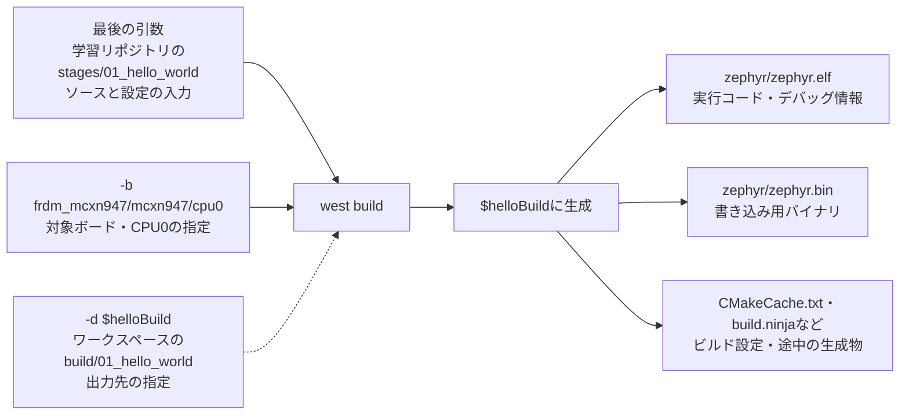

`-d`は保存先を選ぶ指定で、ソースの場所は最後の引数で指定する。`-p always`は、指定したビルドディレクトリの既存の生成物を消してから作り直す指定。上のコマンドは説明用の再掲なので、図を読むために再実行する必要はない。

確認するときはPowerShellで`$helloBuild`の値を表示し、そのフォルダの中に`zephyr\zephyr.elf`や`zephyr\zephyr.bin`ができているかを見る。

<a id="qa-008-supplement"></a>

### QA-008：`$learningRepo`から学習アプリまでの位置関係

`$learningRepo`は学習リポジトリ全体の場所。`stages\01_hello_world`を付け足すと、今回ビルドするアプリの場所になる。線はフォルダの親子関係を示す。

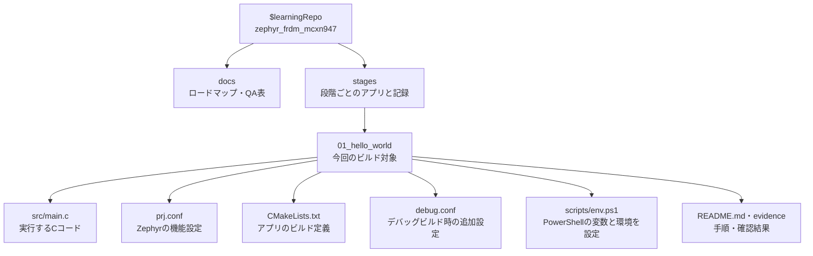

PowerShellの二重引用符の中では変数が展開される。`"$learningRepo\stages\01_hello_world"`は、上のパス表にある「学習アプリ」の絶対パスになる。`$learningRepo`そのものを指定すると、アプリより上のリポジトリ全体を指してしまう。

`$learningRepo`と`"$learningRepo\stages\01_hello_world"`をそれぞれPowerShellで表示すると、どこまでを変数に入れ、どこを付け足したか確認できる。`debug.conf`はファイルを置くだけでは追加されず、デバッグ用ビルドで指定して使う。

<a id="qa-009-supplement"></a>

### QA-009：ソースとビルド結果を分ける今回の構成

この図の線はフォルダの親子関係ではなく、ビルドに使う入力と生成物の流れを示す。

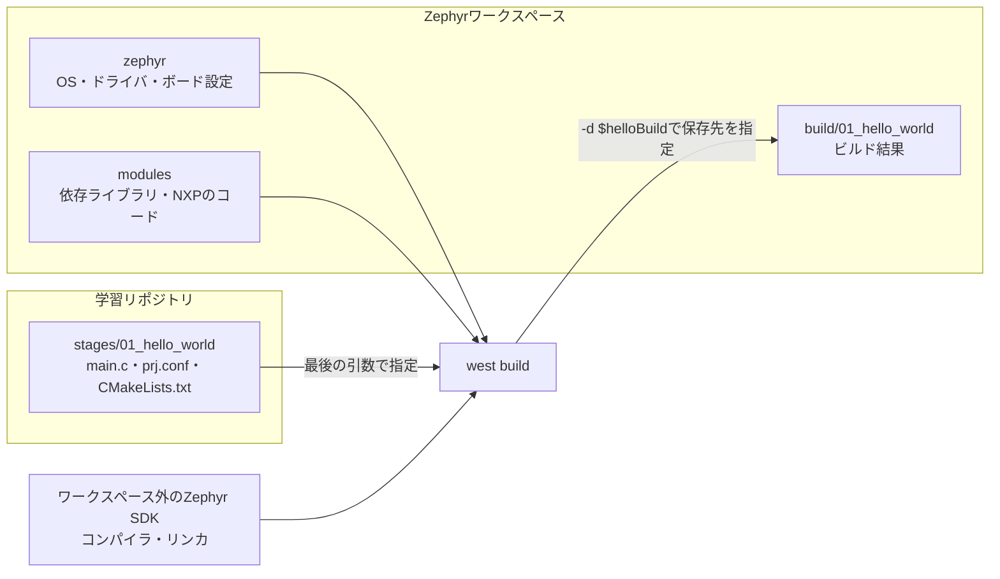

アプリのソースとビルド結果は別のフォルダにあり、ビルドでは自分のアプリとZephyr側のコードを組み合わせる。学習リポジトリを編集しても、生成物の保存先は`-d`の指定に従う。

ソースと生成物を分けるために、今回の2つのルートフォルダへ分割することまでは必須ではない。アプリ内に専用の`build`フォルダを作る配置も使える。今回は、自分が管理する学習コード・記録と、Zephyrの依存コード・生成物を分けるためにこの配置を選んだ。

<a id="qa-010-supplement"></a>

### QA-010：普段編集するものと、ビルドや環境管理で変わるもの

矢印のラベルは「誰が、どのように扱うか」を示す。

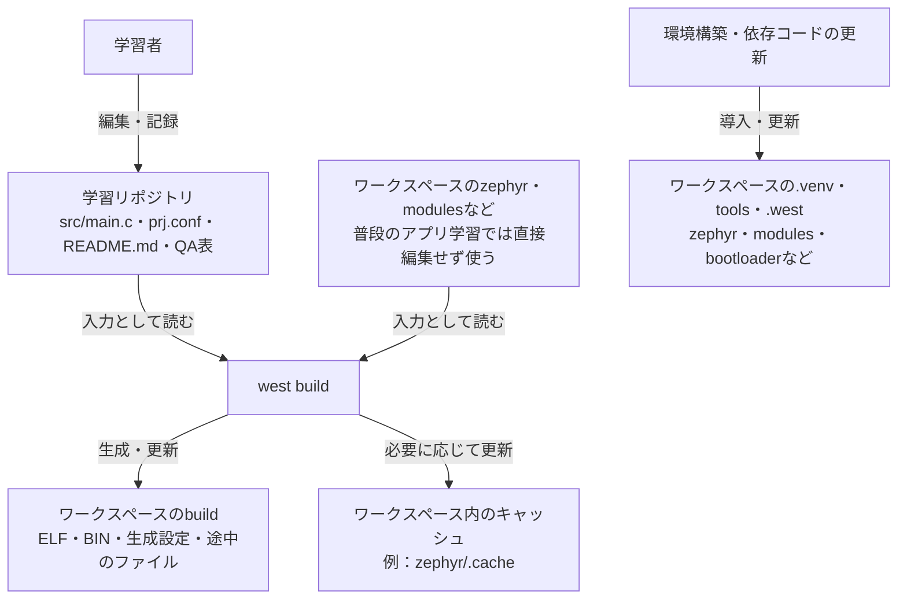

普段の実習では、自分のアプリと学習記録を編集する。一方、ワークスペースはビルド結果を保存するだけの場所ではなく、ツールや依存コードも持つ。ビルドでキャッシュが更新され、環境構築や更新で依存コード・Pythonパッケージなどが変わることもある。

したがって「Zephyr本体や依存ライブラリを普段は直接編集しない」が今回の方針。「ワークスペースではビルド結果以外は一切変わらない」という意味ではない。

<a id="qa-011-supplement"></a>

### QA-011：ワークスペースの中身とFRDM-MCXN947のコード

以下は実際のワークスペースの主要フォルダ。線はフォルダの親子関係を示し、深い階層は途中を省略して1つの枠にまとめている。`tools`・`downloads`・`.venv`などの配置は今回の環境構築で選んだもの。

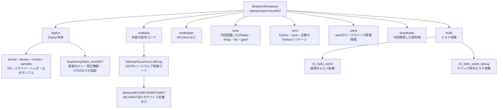

FRDM-MCXN947のボード設定と、MCXN947というチップを制御するNXPのコードは別の場所にある。ボード設定は「この基板でどのピン・周辺機器を使うか」、NXP側のコードは「チップのハードウェアをどう制御するか」をビルドに提供する。

ワークスペースに存在するコードすべてをHello Worldに組み込むわけではなく、対象ボードと機能設定に必要なものをビルドで選ぶ。たとえば`bootloader`にMCUbootのコードがあっても、今回のHello WorldでMCUbootを使っているという意味ではない。

Zephyr SDKはこのツリーの外に置いている。NXPの`mcux-sdk-ng`はチップ制御のコード、Zephyr SDKはGCC・リンカ・GDBなどの道具という違いがある。


<a id="qa-012-supplement"></a>

### QA-012：開発環境の構成図と読み方

ソースコードを編集してから、ビルド・書き込み・デバッグ・UART出力の確認までの関係を示す。以下は今回の実習環境の構成で、ビルド結果はワークスペースの`build`フォルダに保存する。

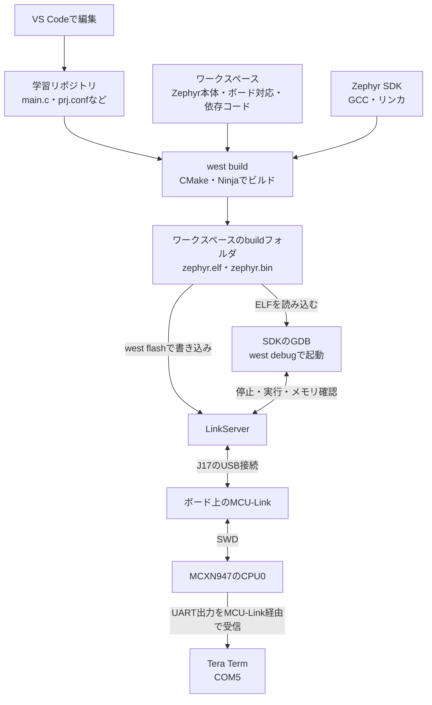

図は次の順に読む。

1. **ビルド**：自分のアプリとZephyrのコード・ボード設定を入力にし、SDKのコンパイラとリンカで実行ファイルを作る。CMakeがビルド手順を生成し、Ninjaがその手順を実行する。
2. **書き込みとデバッグ**：LinkServerがUSB接続のMCU-Linkを操作し、MCU-LinkがSWDというデバッグ用の接続でCPU0を操作する。GDBはELF内のソース位置・変数の情報を使い、LinkServerを通してブレークポイントやステップ実行、メモリ確認を行う。
3. **表示の確認**：CPU0で実行した`printf`のUART出力は、MCU-Linkの仮想COMポートを通ってTera Termに届く。今回のCOMポートはCOM5。Tera Termは出力を読む役割で、ビルドや書き込みは行わない。

<a id="qa-014-supplement"></a>

### QA-014：CMakeの相対ソースパスの基準

対象のCMakeLists.txtは次の場所にある。

```text
C:\Users\grace\Documents\ChatGPT\zephyr_frdm_mcxn947\stages\02_led_control\CMakeLists.txt
```

このファイルを処理しているときの`CMAKE_CURRENT_SOURCE_DIR`は、その親フォルダの
`C:\Users\grace\Documents\ChatGPT\zephyr_frdm_mcxn947\stages\02_led_control`。
`target_sources(app PRIVATE src/main.c)`の`src/main.c`は、この場所を基準に解釈される。

```text
基準：C:\Users\grace\Documents\ChatGPT\zephyr_frdm_mcxn947\stages\02_led_control
相対指定：src/main.c
対象：C:\Users\grace\Documents\ChatGPT\zephyr_frdm_mcxn947\stages\02_led_control\src\main.c
```

これから実行する`west build`では、最後の引数に段階2のアプリフォルダを指定する。
westがそのフォルダをCMakeのソースディレクトリとして渡し、CMakeがそこでCMakeLists.txtを読む。
PowerShellの現在位置がZephyr本体であっても、アプリのソースディレクトリは別に指定できる。
`-d $ledBuild`で指定するビルド結果の保存先も、この相対ソースパスの基準とは別。

`app`はソースを追加するビルド対象名。`PRIVATE`は、このソースをapp自身のビルドに使い、
appに依存する他のビルド対象へソースとして引き継がせない指定。いずれもパスの基準を決めるものではない。

採用CMake 3.31.8の同梱Help（`command/target_sources.rst`、`variable/CMAKE_CURRENT_SOURCE_DIR.rst`、
`policy/CMP0076.rst`）を確認。対応する[公式説明](https://cmake.org/cmake/help/v3.31/command/target_sources.html)。
Codexの事前ビルド先`build/02_led_control_codex/build.ninja`でも、このmain.cの絶対パスを
コンパイル対象として確認した。この確認は本人のビルド結果としては扱わない。

<a id="qa-015-supplement"></a>

### QA-015：printfとprintkの比較

| 項目 | printf | printk |
|---|---|---|
| 提供元 | C標準ライブラリ（libc） | Zephyr |
| ヘッダ | `<stdio.h>` | `<zephyr/sys/printk.h>` |
| 出力先の考え方 | 標準出力stdout | Zephyrのシステムコンソール |
| 戻り値 | int。成功時は出力文字数、エラー時は負の値 | void。戻り値なし |
| 今回の用途 | 段階1のHello Worldで使用 | 段階2のGPIO APIの状態・戻り値を表示 |

```c
/* printfには<stdio.h>、printkには<zephyr/sys/printk.h>が必要。 */
printf("ret=%d\n", ret);
printk("ret=%d\n", ret);
```

今回の構成なら、どちらも同じUARTコンソールへ表示できる。`ret`はGPIO APIが返した値であり、
printkの戻り値ではない。表示するAPIを変えてもGPIOの論理値やLEDの極性は変わらない。

Codexの段階2の事前ビルドで生成した`.config`では、`CONFIG_PICOLIBC=y`、
`CONFIG_STDOUT_CONSOLE=y`、`CONFIG_PRINTK=y`、`CONFIG_UART_CONSOLE=y`を確認。
`CONFIG_LOG`は無効。採用ソースの`drivers/console/uart_console.c`は、stdout側とprintk側に
同じ`console_out`を登録する。`lib/libc/picolibc/stdio.c`はstdoutの出力先へ文字を渡す。
`lib/os/printk.c`はprintkの出力先へ文字を渡し、今回のPicolibc構成では書式処理にvfprintfを使う。

したがって「printkはいつも小さい」「printfは必ずバッファにためる」「printkでは特定の書式が
一律に使えない」という固定的な区別をしない。書式の対応、同期、ログ経由などは設定に依存する。
本人の今回の報告はソースの読み出し結果で、上の生成設定確認はCodexの事前検証を根拠としている。

参照（採用コミットに固定）：

- [printkの宣言](https://github.com/zephyrproject-rtos/zephyr/blob/dccb09599635bdff17633fa7e9dab014b91dce90/include/zephyr/sys/printk.h)
- [printkの実装](https://github.com/zephyrproject-rtos/zephyr/blob/dccb09599635bdff17633fa7e9dab014b91dce90/lib/os/printk.c)
- [UARTコンソールの出力先登録](https://github.com/zephyrproject-rtos/zephyr/blob/dccb09599635bdff17633fa7e9dab014b91dce90/drivers/console/uart_console.c)
- [Picolibcの標準出力接続](https://github.com/zephyrproject-rtos/zephyr/blob/dccb09599635bdff17633fa7e9dab014b91dce90/lib/libc/picolibc/stdio.c)
- [書式付き出力の説明](https://github.com/zephyrproject-rtos/zephyr/blob/dccb09599635bdff17633fa7e9dab014b91dce90/doc/services/formatted_output.rst)

<a id="qa-017-supplement"></a>

### QA-017：statusの有効化と実行時の状態

Devicetreeのstatusは、ハードウェアを表すノードを使用対象として有効にするかを記述する。

| 設定 | 意味 |
|---|---|
| `status = "okay"` | ノードを有効にする |
| `status = "disabled"` | ノードを明示的に無効にする |
| statusを省略 | Zephyrでは有効として扱う |

今回の共通定義はred_ledのstatusをdisabledにし、CPU0用の定義は同じノードを参照して
そのプロパティを上書きする。別の赤色LEDを追加する処理ではない。

```dts
&red_led {
    status = "okay";
};
```

これはCPU0向けの最終Devicetreeでred_ledを有効にする指定。電源投入後に実行されるCの命令ではない。

| 確認／処理 | 確認するもの、変えるもの |
|---|---|
| Devicetreeのstatus | ビルドへ入力するノードの有効化設定 |
| `gpio_is_ready_dt(&led)` | 実行時にgpio0デバイスの初期化が成功して使用可能か |
| `gpio_pin_configure_dt(&led, GPIO_OUTPUT_INACTIVE)` | 実行時にピンを出力に設定し、初期状態を消灯へする |
| `gpio_pin_set_dt(&led, 1)` | 実行時に論理1を指定し、今回のActive Lowの赤色LEDを点灯させる |

ノードをokayにするだけで対応ドライバのコードが必ず組み込まれるわけではなく、Kconfigでの
ドライバ有効化なども必要。今回のred_ledはGPIO情報の取得先として使い、gpio0のドライバを
GPIO APIから操作する。GPIO情報の取得先が有効かをコンパイル時のDT_NODE_HAS_STATUSで確認し、
GPIOデバイスの使用可能状態を実行時のgpio_is_ready_dtで確認する。

okayは設定であり、LEDが実際に点灯したことや動作確認済みであることを表す値ではない。
実機結果は本人の確認を受けて別に記録する。

採用コミットの[Devicetreeのstatusの説明](https://github.com/zephyrproject-rtos/zephyr/blob/dccb09599635bdff17633fa7e9dab014b91dce90/doc/build/dts/intro-syntax-structure.rst)に照合済み。

<a id="qa-018-supplement"></a>

### QA-018：zephyr.dtsの入力・生成先・参照元

`zephyr.dts`は、ビルド時に決まったDevicetreeを一つにまとめた生成ファイル。
今回の生成先は`C:\Users\grace\zephyrproject-mcxn947\build\02_led_control\zephyr\zephyr.dts`。
`west build`の`-d $ledBuild`で指定したビルド先の下に作成され、学習アプリのソースフォルダとは別に置かれる。

今回の入力は、ボード指定`frdm_mcxn947/mcxn947/cpu0`で選ばれた
`C:\Users\grace\zephyrproject-mcxn947\zephyr\boards\nxp\frdm_mcxn947\frdm_mcxn947_mcxn947_cpu0.dts`と、
そこから読み込むCPU0用・共通ボード・SoCなどの`.dtsi`。
overlayを使う場合はその上書きも反映されるが、今回のアプリにはoverlayを追加していない。
`prj.conf`はKconfigへの入力で、`zephyr.dts`へ直接統合する入力ではない。

採用版4.4.2の実際の生成処理：

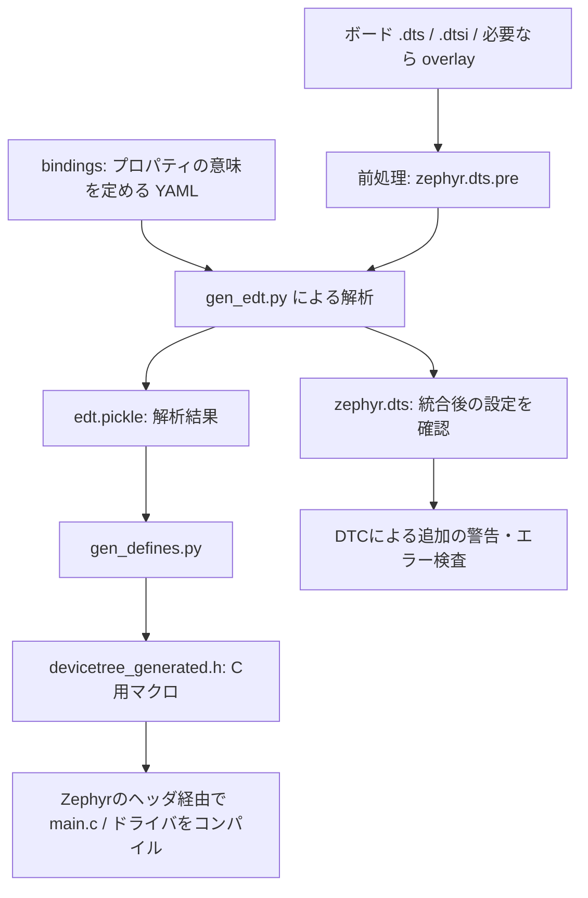

`zephyr.dts`とC用の生成ヘッダは、同じ解析結果から作られる。
採用版では、生成済み`zephyr.dts`を読み直してヘッダを作る経路ではない。
`cmake/modules/dts.cmake`がこの処理を実行し、DTCの検査出力自体は破棄する。

C側は`<zephyr/devicetree.h>`などの通常のZephyrヘッダを経由して生成マクロを使う。
アプリが`devicetree_generated.h`を直接includeする必要はない。
今回の`main.c`は`<zephyr/drivers/gpio.h>`を読み込み、その依存ヘッダを経由してDevicetreeのAPIを使っている。

```c
#define LED_NODE DT_ALIAS(led0)
static const struct gpio_dt_spec led = GPIO_DT_SPEC_GET(LED_NODE, gpios);
```

この記述は、ビルド時に決まった`led0 → red_led → gpio0・ピン10・GPIO_ACTIVE_LOW`の情報を
`led`の初期値に取り込む。実行時にボードが`zephyr.dts`を開いて読む処理ではない。

`zephyr.dts`の役割は、複数の入力の上書きを経た最終設定を確認し、設定の問題を調べること。
たとえばred_ledの`status = "okay"`を見れば、共通定義のdisabledがCPU0用定義で上書きされたことを確認できる。
ビルドで再生成されるため、設定変更は入力のoverlayなどへ行い、生成ファイルを直接編集しない。

参照：採用コミットの[生成処理](https://github.com/zephyrproject-rtos/zephyr/blob/dccb09599635bdff17633fa7e9dab014b91dce90/cmake/modules/dts.cmake)、
[gen_edt.py](https://github.com/zephyrproject-rtos/zephyr/blob/dccb09599635bdff17633fa7e9dab014b91dce90/scripts/dts/gen_edt.py)、
[DevicetreeのC用ヘッダ](https://github.com/zephyrproject-rtos/zephyr/blob/dccb09599635bdff17633fa7e9dab014b91dce90/include/zephyr/devicetree.h)。
公式の[入力・出力ファイルの説明](https://docs.zephyrproject.org/latest/build/dts/intro-input-output.html)も参照し、スクリプト間の分担はローカルの採用版ソースで照合した。

<a id="qa-019-supplement"></a>

### QA-019：overlayを使う場面と今回不要な理由

overlayは、ボードの`.dts`／`.dtsi`を直接編集せずに、アプリに合わせてDevicetreeへ設定を追加・上書きする入力ファイル。
拡張子は通常`.overlay`で、内容はDevicetreeの記述。ビルド時にボード定義の後へ適用され、最終`zephyr.dts`とC用生成ヘッダへ反映される。
実行中に動的に設定を重ねる処理ではない。

判断の基準は「このアプリで必要なハードウェア構成が、選んだボードの既定Devicetreeで表現されているか」。

| やりたいこと・現状 | 設定する場所 |
|---|---|
| 既定のLEDが有効で、ピン・極性・aliasも目的に合っている | 追加overlayなしで既存の情報を使う |
| 使いたい周辺機器が最終Devicetreeでdisabled | overlayで有効化し、必要なピン設定なども確認。ドライバのKconfigも別途確認 |
| 外付けセンサーなど、使うデバイスのノードがない | overlayへ対応ノードと、接続先・アドレスなどを追加 |
| Cコードを変えず、led0などのaliasの割り当てを変えたい | overlayでaliasを上書き |
| GPIO APIやprintkなどのソフトウェア機能を組み込みたい | prj.confでKconfigを設定 |
| 同じLEDを点灯から消灯へ変えたい | main.cの論理値を変更 |

実際の回路・配線とアプリの要件を確認し、対象ボードで生成した`zephyr.dts`と比較する。
変更するDevicetreeプロパティの意味・必要な項目は対応するbindingも確認する。
`status = "okay"`だけで、必要なドライバの組み込みや配線条件まで満たすとは判断しない。

今回の照合結果：

| 必要な情報 | 既定のボード定義と本人の確認結果 |
|---|---|
| 操作するLED | `led0 = &red_led`で赤色LEDを参照できる |
| LEDノードの有効化 | 共通定義ではdisabledだが、CPU0用定義でred_ledがokayになる |
| GPIOデバイスの有効化 | CPU0用定義でgpio0がokayになる |
| ピン・極性 | `gpios = <&gpio0 10 GPIO_ACTIVE_LOW>`がオンボード赤色LEDの制御に合っている |
| 出力・ピンmuxの設定 | 採用版のMCUX GPIOドライバがgpio_pin_configure_dt経由で設定。LED用の追加pinctrl指定は不要 |
| GPIOドライバ | prj.confでGPIOを要求し、本人の.configでGPIOとGPIO_MCUXがy |

このため追加overlayなしで目的を満たせると判断した。生成設定の確認に続き、本人のUARTで準備状態trueと両APIの戻り値0、目視で点灯・消灯も確認済み。

同じCコードの`DT_ALIAS(led0)`を維持したまま、led0を緑色LEDへ割り当てる場合のoverlayの記述例：

```dts
/ {
    aliases {
        led0 = &green_led;
    };
};
```

採用したCPU0用定義ではgreen_ledもすでにokay。これは設定変更の説明用であり、実際のサンプルには追加していない。
元のCコードにある赤色LED向けの表示文は、緑色LEDへ変更するアプリでは合わせて更新する。

参照：[公式のoverlayの使い方](https://docs.zephyrproject.org/latest/build/dts/howtos.html#set-devicetree-overlays)、
採用コミットの[共通ボード定義](https://github.com/zephyrproject-rtos/zephyr/blob/dccb09599635bdff17633fa7e9dab014b91dce90/boards/nxp/frdm_mcxn947/frdm_mcxn947.dtsi)、
[CPU0用定義](https://github.com/zephyrproject-rtos/zephyr/blob/dccb09599635bdff17633fa7e9dab014b91dce90/boards/nxp/frdm_mcxn947/frdm_mcxn947_mcxn947_cpu0.dtsi)。

## 段階6の開始時の説明

| ID | 質問した段階 | 質問日時（JST、代替日時は注記） | 質問のカテゴリ | 質問内容 | 回答 |
|---|---|---|---|---|---|
| QA-037 | 段階6／#7 | 2026-10-14（引き継ぎ依頼の受領日。正確な質問日時は不明） | UART受信API・ISR | 採用版でuart_poll_inの戻り値と入力なし時の動作、割り込みコールバックの実行場所、ISRとスレッドの役割を説明してください。 | uart_poll_inは非ブロッキングで、1バイトを保存できれば0、入力が空なら-1。成功時だけ保存先を使う。採用MCUX LPUART実装はフラグを1回確認する。空のときのk_msleep(1)はアプリ側の待機。割り込みコールバックはドライバISRから呼ばれるためISRの文脈で動く。FIFO読出し、上限・改行判定、K_NO_WAITのキュー投入を短く行い、待ち付きのキュー受取りとUART出力はスレッド側へ置く。採用コミットのローカルソースによる説明であり、本人の理解・実機結果の確認ではない。[段階6の準備記録](../stages/06_uart_echo/README.md)。 |

## 段階6：割り込み受信の図解

| ID | 質問した段階 | 質問日時（JST、代替日時は注記） | 質問のカテゴリ | 質問内容 | 回答 |
|---|---|---|---|---|---|
| QA-038 | 段階6／#7 | 2026-10-24（質問受領日。正確な送信日時は未取得） | UART割り込み・ISR・メッセージキュー | 割り込み版の動作メカニズムが分からないので、ISR側でキューの空きを待たない理由を図解で教えてください。 | CPU0は1個で、ISRは実行中のスレッドへ割り込んで動く。UARTから読んだ文字をISR内で行へ組み立て、完成した行を待たずにキューへコピーして戻る。ISR終了後にmainが行を取り出して送信する。ISRがキューの空きを待って回り続けると、空きを作るmainが動けず進まない。Zephyrの採用実装でもISRからのk_msgq_putはK_NO_WAITだけを許す。今回は満杯なら新しい完成行を捨て、mainが後で通知する。[以下の図と具体例](#qa-038-supplement)を参照。説明後の本人の理解確認はまだ行っていない。 |

<a id="qa-038-supplement"></a>

CPU0は1個で、mainとLEDスレッドはCPU時間を分けて動く。ISR（割り込み処理）は別スレッドではなく、
実行中のスレッドを一時中断して優先的に行う処理。UART回路とRAMのキュー自体がCの処理を実行するわけではない。

次の図は、abcと改行を受け取る複数回の割り込みをまとめて示している。

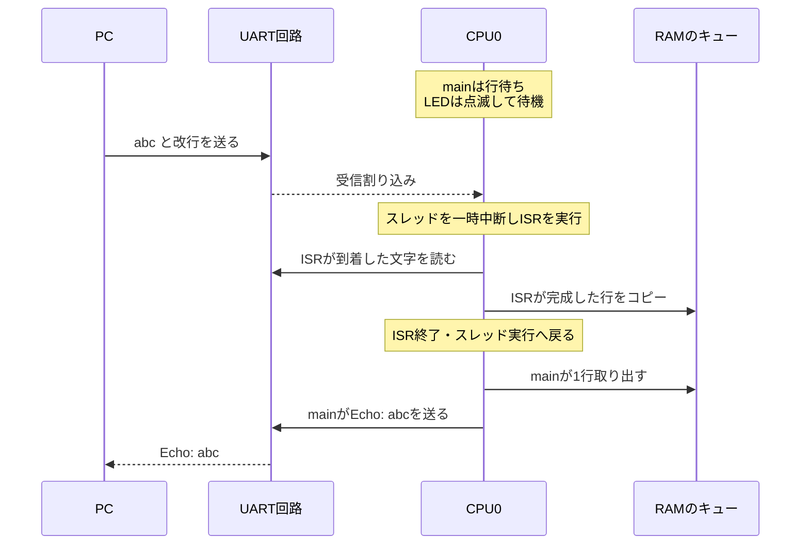

改行前はISRが本文を蓄積するだけで、まだキューへ完成行を渡さない。
改行が届いたら`k_msgq_put(..., K_NO_WAIT)`でコピーし、ISRは終了する。
mainの`k_msgq_get(..., K_FOREVER)`は行がない間mainを待ち状態にし、受信した行を送信できる状態になるとmainを実行可能にする。
mainが待っている間、LEDスレッドが実行可能なら動ける。両方が待ち状態ならCPUはアイドルにも入れる。
割り込みで起こされたmainが、そのISRの途中で実行を始めるわけではない。

キューが10行で満杯のとき、ISR内で「空くまで回り続ける」処理を書いたと仮定すると、次の循環になる。

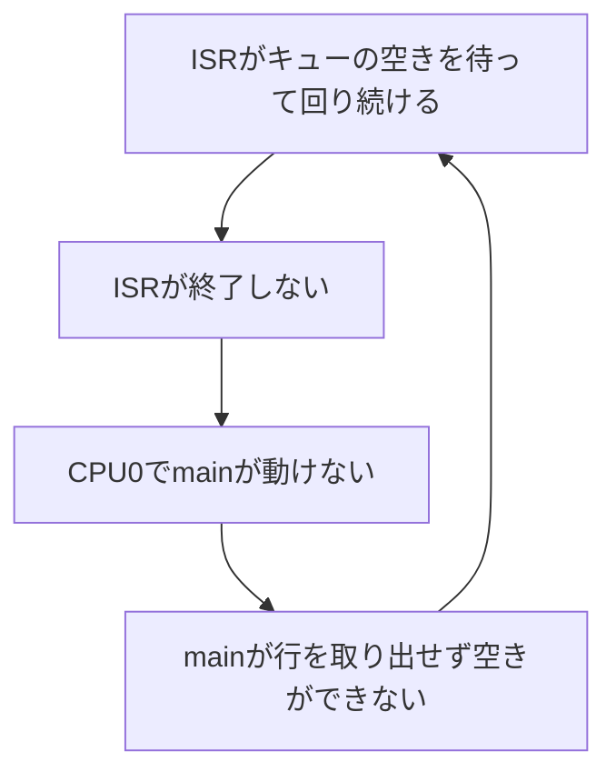

これは待ち続ける処理が不適切な理由の説明であり、ISRで待機APIを使う実装例ではない。
採用Zephyrの`kernel/msg_q.c`のput_msg_in_queueでは、ISRからの呼出しにK_NO_WAITを要求するassert条件を確認した。
実際のアプリは「入るなら投入、満杯なら新しい完成行を捨てて戻る」とし、mainが再開してから通知する。
捨てる単位は今回完成した1行であり、すでにキューにある10行は残す。

今回の001〜100が全部返った理由は、mainも途中で行を取り出して送信するため。
キュー10件は同時に溜めておける上限であり、合計10行しか処理できない意味でも、10行揃うまで待つ意味でもない。
今回の試験では満杯通知や欠番は観測されず、キュー満杯経路の実機確認は未実施として区別する。
PC側の送信間隔や最大キュー占有数は測定していないため、満杯にならなかった細かい時間条件は断定しない。

## 段階6：実際の関数名・変数名で見る受信経路

| ID | 質問した段階 | 質問日時（JST、代替日時は注記） | 質問のカテゴリ | 質問内容 | 回答 |
|---|---|---|---|---|---|
| QA-039 | 段階6／#7 | 2026-10-24（質問受領日。正確な送信日時は未取得） | UART割り込み・ソース読解 | 提示した図を、ソースコードの実際の名称でもう一歩具体的に説明してください。 | irq_line.cのmainがserial_cbを登録し、UART割り込みを有効にする。ISR文脈のserial_cbはuart_fifo_readでcへ読み、receive_byte(c)を呼ぶ。receive_byteがrx_line.textとrx_lenを更新し、改行でrx_lineをrx_queueへコピーする。mainはk_msgq_getで自分のmessageへ受け取り、send_message、uart_send_string、uart_poll_outの順で送信する。rx_lineとmainのmessageは別の構造体。満杯時はqueue_overflowを立ててISRから戻り、mainが後で通知する。[以下の図・abcの具体例](#qa-039-supplement)を参照。 |

<a id="qa-039-supplement"></a>

対象：[割り込み版のソース](../stages/06_uart_echo/src/irq_line.c)。図は正常な本文・改行の経路を中心に示す。
serial_cbはmainからUARTドライバへ登録するコールバック。受信ごとにmainが直接呼ぶ関数ではない。

```c
uart_irq_callback_user_data_set(uart_dev, serial_cb, NULL);
uart_irq_rx_enable(uart_dev);
uart_irq_err_enable(uart_dev);
```

受信割り込みが来ると、採用ドライバのISRからserial_cbが呼ばれる。
serial_cbから呼ぶreceive_byteとrecord_rx_errorsも、その呼出し中はISR文脈で実行される。

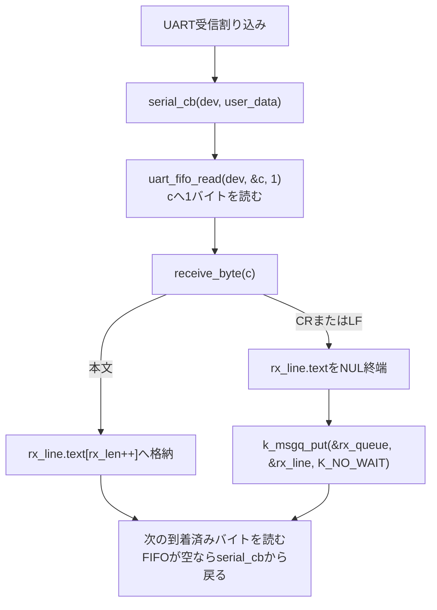

実際のserial_cbはこの読出し前にuart_irq_update、record_rx_errors、uart_irq_rx_readyを呼ぶ。
whileでFIFOが空になるまで読むため、割り込み1回で複数バイトを読む場合もある。
CR直後のLFはprevious_was_crの判定で無視し、完成行を二重に投入しない。

最初の正常行としてabcとCRLFを受信する例：

| c | receive_byte(c)の主な処理 | 処理後のrx_len |
|---|---|---:|
| a | rx_line.text[0]へaを格納 | 1 |
| b | rx_line.text[1]へbを格納 | 2 |
| c | rx_line.text[2]へcを格納 | 3 |
| CR | rx_line.text[3]をNUL終端し、rx_lineをrx_queueへコピー。長さと状態を初期化 | 0 |
| LF | previous_was_crがtrueなのでreturn。2件目を投入しない | 0 |

行終端で配列全体を消す処理はしていない。長さと結果・UARTエラーフラグを初期化し、次の本文で上書きする。
キューへはstruct line_messageの内容がコピーされるため、その後rx_lineを更新しても渡した行は変わらない。

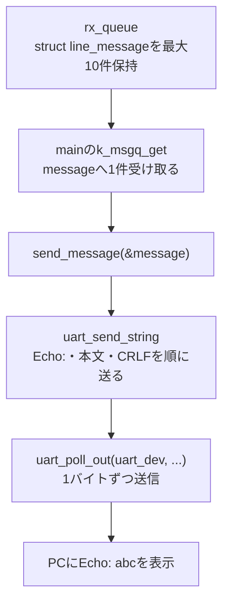

mainの実際の受取りは`k_msgq_get(&rx_queue, &message, K_FOREVER)`。
キューが空ならmainだけが待ち状態になる。受取り後、send_message(&message)へ進む。
mainがすでに受取り待ちなら、カーネルはメッセージを待ち先のmessageへ直接コピーして起こすこともある。
図はメッセージキューAPIを介した受渡しを示し、必ずキューの内部バッファに一度溜まるという意味ではない。

| 名前 | 内容と担当 |
|---|---|
| serial_cb内のc | UARTから読んだ1バイト |
| rx_line | ISR側の組立て用struct line_message。text・result・uart_errorsを持つ |
| rx_len | ISR側で本文を何バイト蓄積したか |
| rx_queue | 完成したメッセージを受け渡すキュー |
| main内のmessage | mainが受け取る別のstruct line_message |
| send_message内のmessage | mainから渡された構造体へのポインタ。message->textで本文を読む |

キュー満杯ではreceive_byteのk_msgq_putが失敗し、atomic_set(&queue_overflow, 1)を行う。
その行は捨ててserial_cbから戻り、mainが再び動けるようにする。
mainは行を受け取った後、atomic_clear(&queue_overflow)の戻り値で通知の有無を確認し、エラー表示する。
receive_byteが空くまで回り続けるとserial_cbが戻れず、空きを作るmainのk_msgq_getも進めない。
そのためISR側はK_NO_WAITで投入する。これは前の一般図を実際の関数名へ対応づけた説明である。

led_entryはk_thread_createで作る別スレッドで、gpio_pin_set_dtとk_msleep(250)を繰り返す。
serial_cbが戻り、LEDスレッドが実行可能なら点滅処理が動く。LED側はUARTへ送信しない。

## 段階7への移行時の質問

| ID | 質問した段階 | 質問日時（JST、代替日時は注記） | 質問のカテゴリ | 質問内容 | 回答 |
|---|---|---|---|---|---|
| QA-040 | 段階6完了後／段階7前 | 2026-10-30（チャットの受領日。正確な送信日時は未取得） | 学習計画・次の段階 | 次の段階は何ですか？ | 記録では段階6が完了しているため、次は段階7「NT-Shellを組み込みLED制御コマンドを追加する」／#8。公式配布物の取得元・バージョン・ライセンス確認、UARTへの接続、LEDコマンド、ご本人のビルド・実機確認の順に進める。[段階7の手順](../stages/07_ntshell/README.md)。 |

## 段階7の質問

| ID | 質問した段階 | 質問日時（JST、代替日時は注記） | 質問のカテゴリ | 質問内容 | 回答 |
|---|---|---|---|---|---|
| QA-041 | 段階7／#8 | 2026-10-31（質問受領日。正確な送信日時は未取得） | UART割り込み・ISRとコールバック | 説明中のISRとはserial_cb関数のことですか？ | 説明で「ISR側」と呼んだアプリ側の処理はserial_cbを指す。厳密にはISRはInterrupt Service Routine（割り込み処理ルーチン）という役割名で、serial_cbはドライバのISRから直接呼ばれる登録済みコールバック。採用MCUX LPUARTではmcux_lpuart_isrからmcux_lpuart_irq_driven_isrを経て登録済みcallbackが呼ばれ、serial_cbも割り込みの実行文脈で動く。serial_cb専用スレッドはない。mainのserial_port_initがコールバックを登録し、serial_port_startが受信・エラー割り込みを有効にする。ISR側では待たずにキューへ投入し、待ち付き受取りと送信はmain側へ置く。採用ローカルドライバと[段階7ソース](../stages/07_ntshell/src/serial_port.c)を照合した説明であり、今回の本人の実機確認ではない。 |
| QA-042 | 段階7／#8 | 2026-10-31（質問受領日。正確な送信日時は未取得） | Cの関数ポインタ・コールバック登録と呼出し | UARTドライバのISRは、なぜserial_cbを呼び出せるのですか？ | アプリが登録APIへserial_cbの関数ポインタを渡し、ドライバがデバイスごとのdata->callbackへ保存するため。共通APIはdev->apiのirq_callback_setを呼び、MCUXのmcux_lpuart_irq_callback_setがcallbackとcb_dataを保存する。割り込み時にmcux_lpuart_irq_driven_isrがdata->callback(dev, data->cb_data)を実行し、保存されたポインタの先にあるserial_cbへ制御を移す。登録時にはserial_cbを実行せず、割り込み時には同じISR文脈の関数呼出しとして実行する。staticは他のソースから名前を直接参照できる範囲を制限するが、渡したポインタによる呼出しを妨げない。[実際の登録と呼出しの対応](#qa-042-supplement)を参照。 |
| QA-043 | 段階7／#8 | 2026-10-31（質問受領日。正確な送信日時は未取得） | ソフトウェア構成・関数の所属と関係 | 自作関数、Zephyr API、Zephyrデバイスドライバ、NT-Shellなどの所属と関係を図で整理してください。 | 関数の実装元による分類と、ISR／main／LEDスレッドという実行文脈を分けて説明する。自作4モジュール、NT-Shellのcore／util、Zephyrのカーネル・共通デバイスAPI・MCUXドライバ、NXP HAL、C標準ライブラリを分類。関数呼出し、登録済みコールバック、キューによるデータ転送とセマフォ通知を図示し、CMake・Kconfig・Devicetreeはビルド時の仕組みとして区別する。[所属表と整理図](#qa-043-supplement)を参照。 |
| QA-044 | 段階7／#8 | 2026-10-31（質問受領日。正確な送信日時は未取得） | ボードターゲット・CPUコア・マルチスレッド | ビルド指定のcpu0以外の指定もありますか？ | MCXN947にはArm Cortex-M33が2コアあり、採用Zephyrにはfrdm_mcxn947/mcxn947/cpu1も定義されている。cpu0は主コア、cpu1は副コアのプログラムを作る指定。採用版ボード資料では単独実行できるのはCPU0で、CPU1はCPU0側から有効化する必要がある。デュアルコア構成ではSysbuildとCONFIG_SECOND_CORE_MCUXなどを使用し、単に今回の-bをcpu1へ置き換えるだけでは済まない。段階7のmainとLEDスレッドはどちらもCPU0上でZephyrが切り替えて実行し、スレッド名とCPUコア番号は別。今回の実習はcpu0を継続する。採用ローカルboard資料・cpu1のyaml／defconfigと[公式ボード資料](https://docs.zephyrproject.org/latest/boards/nxp/frdm_mcxn947/doc/index.html#targets-available)を照合。CPU1向けビルド・実機確認は未実施。 |
| QA-045 | 段階7／#8 | 2026-10-31（質問受領日。正確な送信日時は未取得） | ConsoleとShell・機能比較 | Zephyrには標準でコンソール／シェルが使えますか？ 他環境で使っていたNT-Shellとの特徴と機能差を教えてください。 | Zephyrには文字入出力のConsoleと、コマンド登録・解析・補完・ヘルプ等を備える標準Shellがある。NT-Shellとの比較対象は標準Shell。両者とも編集・履歴を備えるが、NT-ShellのTabは履歴からの候補、ZephyrのTabは登録コマンド・サブコマンドに基づく補完。NT-ShellはOS非依存のCライブラリで入出力とコマンド処理をアプリへ接続し、Zephyr ShellはZephyr向けにログ・診断コマンド・複数バックエンドと統合されている。今回の総Flash／RAMをライブラリ単体の容量として比較しない。[Consoleの区別と比較表](#qa-045-supplement)を参照。今回の実装・設定は変更していない。 |

<a id="qa-042-supplement"></a>

### QA-042補足：関数の呼び出し先を登録して保存する

採用Zephyr SHAのローカル`include/zephyr/drivers/uart.h`、`include/zephyr/drivers/uart/uart_internal.h`、
`drivers/serial/uart_mcux_lpuart.c`と段階7の`serial_port.c`を照合した。

アプリの`serial_port_init()`は次を実行する。

```c
uart_irq_callback_user_data_set(uart_dev, serial_cb, NULL);
```

関数名`serial_cb`を引数に渡すと、呼び出し先を表す関数ポインタとして渡される。この時点では`serial_cb`の本体を実行しない。
`serial_cb`と`&serial_cb`はこの用途では同じ関数を指す。
関数ポインタの型`uart_irq_callback_user_data_t`は、deviceポインタとvoidポインタを受け取り、値を返さない関数に対応する。

共通APIは`dev->api`からUARTのAPI表を取得し、`api->irq_callback_set(dev, cb, user_data)`を呼ぶ。
MCUXのAPI表は`.irq_callback_set = mcux_lpuart_irq_callback_set`であり、その登録関数が次を保存する。

```c
data->callback = cb;       /* 今回はserial_cbを指す。 */
data->cb_data = cb_data;   /* 今回はNULL。 */
```

`data`はそのUARTデバイスの`dev->data`が指すドライバの状態領域であり、登録APIのローカル変数だけに保存しているわけではない。
登録関数から戻った後も呼出し先は保持される。

UART割り込みのドライバ処理では、`mcux_lpuart_isr()`から`mcux_lpuart_irq_driven_isr()`へ進み、次を実行する。

```c
if (data->callback) {
    data->callback(dev, data->cb_data);
}
```

保存した関数ポインタの先へ制御を移すので、この時点で実行されるのが`serial_cb(dev, NULL)`となる。
ドライバがアプリの関数名をハードコードしたり、名前を検索したりしているわけではない。
`serial_cb`の`static`は名前の参照範囲をこのCファイルに限定するが、ファイル内から渡した関数ポインタ経由の呼出しは可能。

```text
初期化時：serial_cbの関数ポインタ → 登録API → data->callbackへ保存
割り込み時：ドライバのISR → data->callback(...) → serial_cbの本体を実行
```

この呼出しで新しいスレッドを起動しない。`serial_cb`とそこから呼ぶ受信・キュー投入処理もISR文脈で動く。
`serial_cb`から戻った後はドライバのISRの続きを実行し、割り込み処理終了後にスレッド実行へ戻る。
これはソースによる説明であり、実機の追跡結果ではない。その後、本人から関数ポインタの登録・呼出しの仕組みが分かったとの報告を受領した（2026-10-31）。本人に再説明を求める確認は行っていない。

<a id="qa-043-supplement"></a>

### QA-043補足：段階7の関数の所属と関係

対象は段階7の実機アプリ。採用Zephyr SHA `dccb09599635bdff17633fa7e9dab014b91dce90`のローカルソース、
取り込み済みNT-Shell 0.3.1のソースとCMakeLists.txtを照合した。テスト用の置換関数は含めない。
本人から関数ポインタの登録・呼出しの仕組みが分かり、serial_port.cも確認済みとの報告を受領した（2026-10-31）。
以下の図は説明用で、実機のトレース結果ではない。
その後、本人から図で関数の分類・関係性が分かったとの報告を受領した（2026-10-31）。

関数の所属は「どのソースが実装しているか」で決まり、実行文脈は「どのスレッドまたはISRが呼ぶか」で決まる。
NT-Shellから呼ばれるserial_read／serial_write／command_callbackも自作関数であり、UARTドライバから呼ばれるserial_cbも自作関数である。
mainも自作関数で、Zephyrがアプリの入口として呼ぶ。

#### 自作関数の全体

| 実装ファイル | 自作関数 | 主に使う他モジュールの機能 |
|---|---|---|
| src/main.c | main | 自作のserial_port_init、led_control_init、serial_puts、serial_port_start。NT-Shellのntshell_init、ntshell_set_prompt、ntshell_execute |
| src/serial_port.c | serial_port_init、serial_port_start、serial_read、serial_write、serial_puts、serial_rx_failed、serial_cb、read_one、record_errors | ZephyrのUART共通API、device_is_ready、メッセージキュー、atomic、割り込みロック。C標準のstrlen |
| src/commands.c | command_callback、dispatch、parse_interval、usage | NT-Shell utilのntopt_parse。自作serial_rx_failed、serial_puts、led_control_apply、led_control_take_error。C標準のstrlen、strcmp |
| src/led_control.c | led_control_init、led_control_apply、led_control_take_error、led_entry | ZephyrのGPIO共通API、スレッド、メッセージキュー、セマフォ、atomic |

#### 外部ソフトウェアとAPIの分類

| 分類 | 今回使う関数／API例 | 実装・役割 |
|---|---|---|
| NT-Shell coreの公開API | ntshell_init、ntshell_set_prompt、ntshell_execute | third_party/ntshell/core/ntshell.c。シェルの初期化・プロンプト・実行ループ |
| NT-Shell coreの内部処理 | vtrecv_init／vtrecv_execute、vtrecv_callback、actfunc_enterなどのactfunc_*、text_editor_*、text_history_*、vtsend_*、ntlibc_* | 同core配下。VT制御文字の解析、編集、履歴、端末制御の送信、文字列補助。ntlibc_strlenなどはNT-Shellの関数でありC標準のstrlenとは別 |
| NT-Shell util | ntopt_parse | third_party/ntshell/util/ntopt.c。確定した行をargc／argvへ分割し、自作dispatchを呼ぶ。どの単語をLEDコマンドとするかはアプリが決める |
| Zephyrのカーネル・同期・割り込みAPI | k_thread_create、k_msgq_put／get／purge、k_sem_take／give、atomic_get／set／clear、irq_lock／unlock | スレッド・待機・データ受け渡し・共有フラグ・割り込み排他。APIの一部はinline関数やマクロ経由。実装はkernel/、include/zephyr/、arch/など |
| Zephyrの共通デバイスAPI | device_is_ready、gpio_is_ready_dt、gpio_pin_configure_dt、gpio_pin_set_dt、uart_irq_callback_user_data_set、uart_irq_rx_enable、uart_irq_err_enable、uart_irq_update、uart_irq_rx_ready、uart_fifo_read、uart_err_check、uart_poll_out | include/zephyr/device.h、include/zephyr/drivers/uart.h／uart/uart_internal.h、gpio.hなど。デバイス共通の入口から、必要に応じてAPI表に登録された機種向けドライバへ進む |
| ZephyrのMCUX UARTドライバ内部 | mcux_lpuart_irq_callback_set、mcux_lpuart_isr、mcux_lpuart_irq_driven_isr、mcux_lpuart_fifo_read、mcux_lpuart_poll_out、mcux_lpuart_err_checkなど | drivers/serial/uart_mcux_lpuart.c。MCXのLPUARTに合わせた具体的な処理。共通APIの名前と内部関数名は別 |
| ZephyrのGPIOドライバ内部 | gpio_mcux_port_set_bits_raw、gpio_mcux_port_clear_bits_rawなど | drivers/gpio/gpio_mcux.c。GPIO出力レジスタを操作。gpio_pin_set_dtから共通の補助関数・API表を経由して到達する |
| ZephyrのLP Flexcommドライバ | nxp_lp_flexcomm_isr、nxp_lp_flexcomm_setirqhandler | drivers/mfd/mfd_nxp_lp_flexcomm.c。今回のボードではFlexcommの割り込みをUART子デバイスのmcux_lpuart_isrへ振り分ける。アプリのserial_cbを登録する処理とは別の階層 |
| NXP MCUX SDK／HAL | LPUART_GetStatusFlags、LPUART_ReadByte、LPUART_WriteByteなど | modules/hal/nxp以下。ZephyrのUARTドライバから利用されるNXPの周辺回路操作。GPIOドライバの今回の出力処理はHAL関数を経由せずレジスタへ直接書く |
| C標準ライブラリ | strlen、strcmp | 文字列の長さ・比較。今回のビルドはPicolibc。Zephyrのカーネル関数とは別 |

ZephyrのデバイスドライバもZephyrの一部である。ここでは利用者向けの共通APIと、ハードウェア向け実装を分けた。
各APIが必ず独立した実行時関数呼出しになるとは限らず、inline化やコンパイラの最適化もある。

#### ソフトウェアの依存・呼出し関係

実線は通常の呼出し／利用、点線は登録された関数ポインタによるアプリへの呼出しを表す。

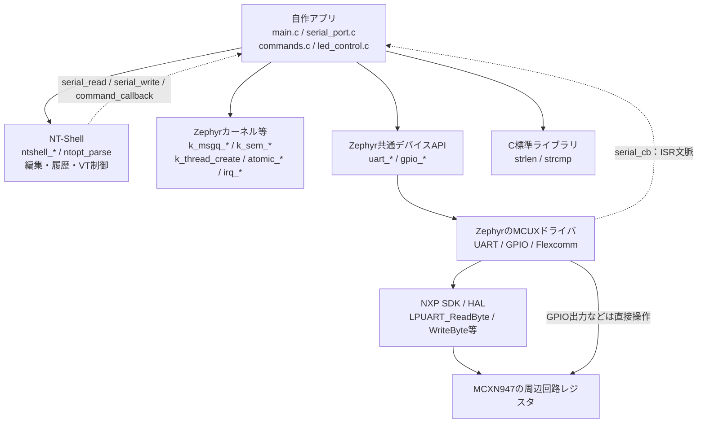

この図はソフトウェアの関係であり、上から順に一度ずつ実行するという意味ではない。
NT-Shellには今回のLEDコマンドの実装もZephyr用のUART処理も含まれず、アプリがコールバックでつなぐ。

#### UART受信から行確定までのデータの流れ

矢印のラベルで関数呼出し、キューへのコピー、取り出し、戻り値を区別する。

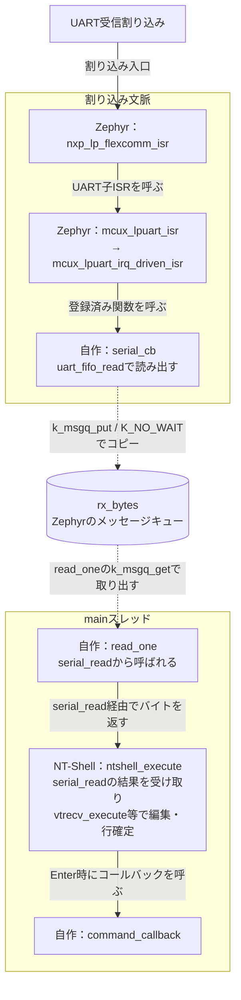

ntshell_executeがmainでserial_readを呼び、serial_readがread_oneを呼ぶ。
この図のread_oneからNT-Shellへの矢印は受信バイトを返す方向であり、read_oneがntshell_executeを呼ぶわけではない。
ISRからmainのread_oneを直接呼ぶこともない。キューへデータを置き、mainが取り出す。
serial_cbから呼ぶuart_fifo_readなどもISR文脈で動く。

#### LEDコマンドの解析・指示・反映

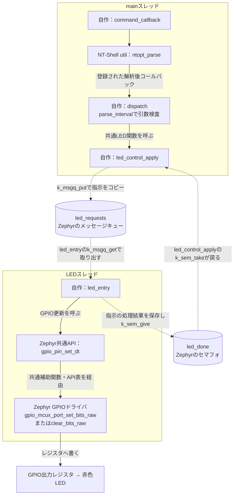

led_entryは受信した指示の初回GPIO反映後にmainへ結果を通知する。
その後の点滅切り替えはLEDスレッドのk_msgq_getのタイムアウトを使って継続する。
mainとLEDスレッドは別の実行単位だが、CPU0上でZephyrが切り替えて実行する。
NT-Shellはmainの関数呼出しの中で動き、NT-Shell専用スレッドは作っていない。

#### マクロ・設定・ビルド時の役割

| 項目 | 分類・役割 |
|---|---|
| K_MSGQ_DEFINE、K_SEM_DEFINE、K_THREAD_STACK_DEFINE | Zephyrの定義用マクロ。キュー・セマフォ・スタックなどの領域や初期情報を用意する |
| K_NO_WAIT、K_FOREVER、K_MSEC | Zephyrの待機時間を指定する定数・マクロ。これだけで待機を開始するわけではなく、APIへ渡して使う |
| DT_CHOSEN、DT_ALIAS、GPIO_DT_SPEC_GET、DEVICE_DT_GET | ZephyrのDevicetree／デバイス参照用マクロ。ボードの生成定義に基づくデバイスやGPIO設定をCから参照する |
| ARG_UNUSED | 未使用引数を明示するZephyrのマクロ |
| CMakeLists.txtのtarget_sources等 | ビルド時のCMakeコマンド。今回の自作ソースとNT-Shellのソースをアプリへ組み込む |
| prj.confのCONFIG_* | Kconfigの設定。UART・GPIO・スレッドなどの有効化とスタック設定。Cの関数ではない |
| NT-ShellとCONFIG_SHELL | 今回はNT-Shellをアプリへ組み込み、Zephyr標準ShellはCONFIG_SHELL=nで無効にする |

全体を1つのファームウェアへリンクする。モジュールごとに独立したプロセスが起動する構成ではない。
関数の名前の接頭辞だけではなく、その定義ファイル・登録先・呼出し元で所属を判断する。

<a id="qa-045-supplement"></a>

### QA-045補足：Zephyr標準Console・ShellとNT-Shellの比較

比較基準は今回固定しているZephyr 4.4.2と、公式配布NT-Shell 0.3.1。
公式Web資料も参照し、比較に挙げた機能は採用ローカルソースと資料で照合した。
Zephyrの`doc/services/shell/index.rst`、`include/zephyr/console/console.h`、`subsys/shell/Kconfig`、
`subsys/shell/backends/Kconfig.backends`、公式shell_moduleサンプル、取り込み済みNT-Shellのntshell.c／ntconf.h／ntopt.cを確認した。

#### ConsoleとShellの違い

| 機能 | 主な役割 | コマンドの意味を解釈するか |
|---|---|---|
| Zephyr Console | 文字入出力。設定に応じてprintkの出力先や、console_getchar／console_getline等の入力APIを使う | Consoleだけではled onなどのコマンド処理は提供しない |
| Zephyr標準Shell | プロンプト、編集、コマンド登録・解析、補完、ヘルプ | 登録されたコマンドのハンドラへ振り分ける |
| NT-Shell | OSに依存しない入力編集・履歴・VT端末制御のライブラリ。確定行をアプリのコールバックへ渡す | 今回はntopt_parseと自作dispatchでコマンドを処理する |

従って、NT-Shellと機能比較する相手はZephyrの標準Shellである。
Zephyrに標準で含まれることと、各アプリのビルドで有効になっていることは別。
標準ShellではCONFIG_SHELLと適切なバックエンドを設定する。
現在の段階7はCONFIG_SHELL=n、CONSOLE／CONSOLE_SUBSYS／PRINTK／LOGも無効で、UART APIを直接使ってNT-Shellへ接続している。

#### 機能と特徴の比較

Zephyrの各機能は、必要なKconfig設定・バックエンド・デバイスが有効な場合に利用できる。
NT-Shell欄では、ライブラリ本体と今回アプリが追加した処理を区別する。

| 項目 | NT-Shell 0.3.1 | Zephyr標準Shell |
|---|---|---|
| 依存・移植 | C89互換。OS・C標準ライブラリへの依存や動的メモリ確保なし。read／writeコールバックで他環境へ接続しやすい | Zephyrのカーネル・デバイス・Kconfigへ統合された機能。他OSへ移す際はZephyr依存部分の移植が必要 |
| 入力編集・履歴 | Backspace、カーソル移動、Ctrl+C、履歴などを備える。今回のntconf.hは編集領域64 B・履歴8件 | 編集・履歴・複数行表示などを備え、Kconfigで機能や領域を調整 |
| Tab | 入力済み履歴から候補を探す。未実行の登録コマンド名を網羅して補完する仕組みは本体にない | 登録したコマンド・サブコマンドを候補表示・補完する |
| コマンド追加 | 確定行コールバックで処理。ntopt_parseは単語分割とコールバック呼出しを提供。今回のdispatchがLEDコマンドの意味を決める | SHELL_CMD_REGISTER等のマクロでコマンド・サブコマンド・ハンドラを登録。引数数の検査も指定できる |
| ヘルプ | 今回は自作usage／helpで説明文字列を表示する | 登録時の説明文を使い、コマンドごとの-h／--help等を提供 |
| Zephyr診断機能 | Zephyr向けの診断コマンドはアプリで追加・接続する | 設定によりkernel、device、GPIO、I2C、sensor、flash等のコマンド群を利用できる。全機能が既定で有効という意味ではない |
| ログとの共存 | 本体にZephyr Loggingとの統合はない。入力行とログの表示調整は追加対応が必要。今回はLOG=n | CONFIG_SHELL_LOG_BACKENDでZephyr Loggingと統合し、シェル出力とログを調整する |
| 入出力経路 | 抽象化されたread／writeをアプリが実装する。UART以外もコールバック実装で対応する | UART、USB CDC ACM、RTT、Telnet、Bluetooth LE NUS等のバックエンドを利用できる。対応機器と設定は別途必要 |
| 実行方法 | ライブラリはスレッドを作らず、呼出し側が実行場所を決める。今回はmainでntshell_executeを動かす | 通常のマルチスレッド構成ではShellのインスタンス用スレッドが処理を担当する |
| 容量調整 | 小さな機能構成と固定領域。実装が少なく追いやすいが、Zephyr向けの接続・追加機能はアプリ側に置く | Kconfigで機能を選択し、CONFIG_SHELL_MINIMALを基準に必要機能だけ追加する構成も可能 |

Tabの具体例：NT-Shellでは一度`led blink 250`を入力した後、その履歴を候補にできる。
Zephyr Shellでは`led`や`blink`をコマンドツリーへ登録していれば、実行履歴がなくてもその名前を補完できる。

どちらも今回のLEDのON／OFF・点滅間隔の意味とGPIO操作はアプリの処理が必要。
Zephyr Shellへ変更する場合も、LED操作の共通関数は利用し、シェル側のハンドラと出力・受信経路を適合させる。
現在のserial_cbと標準ShellのUART受信を同じUARTで同時に有効化する変更は、コールバック所有権が競合するため避け、受信担当を設計し直す。
この比較では実装・設定の切替えは行っていない。

#### 今回の選定とメモリ使用量

Zephyr専用の診断・操作用CLIを作るなら、統合機能のある標準Shellが有力な候補になる。
他のOSやベアメタル環境のNT-Shellコード・操作感を引き継ぐ場合は、NT-ShellのOS非依存性が役立つ。
段階7は外部OSSの取り込み・CMake統合・UART入出力コールバック・独自コマンド解析を学ぶ課題でもあり、今回のNT-Shell構成でこれらを学べる。

今回のFlash 31,376 B・RAM 10,864 BはZephyr、ドライバ、スレッド、キュー、アプリとNT-Shellを含む全体値。
NT-Shell単体の使用量として扱わず、同等機能のZephyr Shell版との容量比較は未実施とする。
公式サイトのNT-Shellの概算ROM／RAM値も今回のビルド結果の代わりにはしない。

参照した一次資料：

- [Zephyr Console API](https://docs.zephyrproject.org/latest/doxygen/html/group__console__api.html)
- [Zephyr Shell](https://docs.zephyrproject.org/latest/services/shell/index.html)
- [NT-Shellの特徴と編集キー](https://cubeatsystems.com/ntshell/)
- [NT-Shell API](https://cubeatsystems.com/ntshell/api.html)
- [NT-Shell公式配布一覧](https://cubeatsystems.com/ntshell/download.html)
- 採用版のローカルソースと段階7の[取得・固定情報](../stages/07_ntshell/UPSTREAM.md)

## 段階8の質問

| ID | 質問した段階 | 質問日時（JST、代替日時は注記） | 質問のカテゴリ | 質問内容 | 回答 |
|---|---|---|---|---|---|
| QA-046 | 段階8／#9 | 2026-10-31（質問受領日。正確な送信日時は未取得） | Kconfigの既定値・明示的な無効化 | Console・Shell・PRINTK・LOG等はデフォルトがyだから明示的にnにしていますか？ | すべてが既定でyではない。採用ZephyrのCPU0ボードdefconfigはCONSOLE・UART_CONSOLEをyにし、PRINTK・BOOT_BANNERの定義はdefault y。一方SHELL・LOG・CONSOLE_SUBSYSは通常の既定値がn。今回は有効な既定設定を解除する指定と、使わない機能を明記する指定を併用し、UARTを自作NT-Shell経路で扱う。BOOT_BANNERはPRINTKをselectするため両方を無効化する。prj.confはボードdefconfigの指定に優先するが、nの明記が他機能のselectを強制的に覆すわけではなく、最終状態は生成.configで確認する。採用ローカルのboard defconfig・各Kconfigと[公式の設定マージ説明](https://docs.zephyrproject.org/latest/build/kconfig/setting.html#the-initial-configuration)を照合。ソース変更・追加ビルドは行っていない。本人のCMake・設定確認完了や外部OSS照合結果はまだ未受領。 |
| QA-047 | 段階8／#9 | 2026-10-31（質問受領日。正確な送信日時は未取得） | Kconfigのselect | BOOT_BANNERがPRINTKを有効化するselectとは何ですか？ | selectは、選択元がyのとき選択先の設定をyにするKconfigの指定。採用版kernel/KconfigのBOOT_BANNERにはselect PRINTKがあり、起動バナーを有効にするとPRINTKも有効になる。BOOT_BANNER=yのままPRINTK=nを指定しても、このselectにより最終的なPRINTKはyになる。今回は両方をnにしてこの経路での有効化も止める。BOOT_BANNER=nだけでPRINTKまでnになるわけではなく、PRINTKには自身のdefault yもある。Cの関数呼出しではなく、ビルド時の設定決定の仕組み。[公式のselect説明](https://docs.zephyrproject.org/latest/build/kconfig/tips.html#select-statements)も照合。設定・ソースの変更や追加ビルドは行っていない。 |
| QA-048 | 段階8／#9 | 2026-10-31（質問受領日。正確な送信日時は未取得） | アプリ設定と生成設定・段階ごとの独立ビルド | $memoryBuild/zephyr/.configとstages/03_led_blink/prj.confはどういう関係ですか？ | prj.confは各アプリ向けに人が用意する入力設定、.configはそのビルドでボード設定・アプリ設定とKconfigの既定値や依存条件から決定した最終設定。今回の$memoryBuildは外部workspaceのbuild/08_memory_ramであり、入力はstages/08_memory_ram/prj.conf。段階3のprj.confは今回のビルドでは参照・継承・自動マージしない。段階3をビルドした際には段階3のprj.confを基に、そのビルド先に別の.configが生成される。段階3のPRINTK=yと段階8のPRINTK=nの違いも、アプリごとに独立しているため矛盾しない。段階8のCMakeCacheのCONF_FILEも確認済み。[公式の設定生成説明](https://docs.zephyrproject.org/latest/build/kconfig/setting.html#the-initial-configuration)を参照。設定ファイルの変更や追加ビルドは行っていない。 |
| QA-049 | 段階8／#9 | 2026-10-31（質問受領日。正確な送信日時は未取得） | GDBのページ送り | (gdb)と表示されるまで2回Enterを押しましたが大丈夫ですか？ | 問題ない。提供ログにType RET for moreの待機が2回あり、Enterは次のページの出力を表示する操作。set pagination offで以後のページ送り待機を無効にできる。提供ログではCPU0接続・段階8 ELFの34,200 Bロードが完了して(gdb)へ到達した。補助プローブブートエラーとロード前resetのエラーは、その後の接続・ロード完了と区別する。ロード後のreset・continueとRAM照合は次に確認する。[GDB公式のページ送り説明](https://sourceware.org/gdb/current/onlinedocs/gdb.html/Screen-Size.html)を参照。 |
| QA-050 | 段階8／#9 | 2026-10-31（質問受領日。正確な送信日時は未取得） | GDB終了後の復旧・RESET | GDB終了後にled offとmem readへ反応しません。リセットしてよいですか？ | ボードのRESETで復旧確認してよい。GDBでの既知パターン照合の確認記録は残るが、RAMは起動時の初期パターンへ戻り、先頭32 bitのread期待値は0x03020100になる。終了後の自動再開は未成功として記録し、原因は終了時のmonitor・detach・quitの応答と終了コードから確認する。RESET後の起動・help・read・LEDを確認する手順を案内。質問時点では復旧結果は未確認。 |

## 関連する記録

- [学習ロードマップ](roadmap.md)
- [段階0の選定記録](../stages/00_versions/versions.md)
- [段階1の手順と本人の実習結果](../stages/01_hello_world/README.md)
