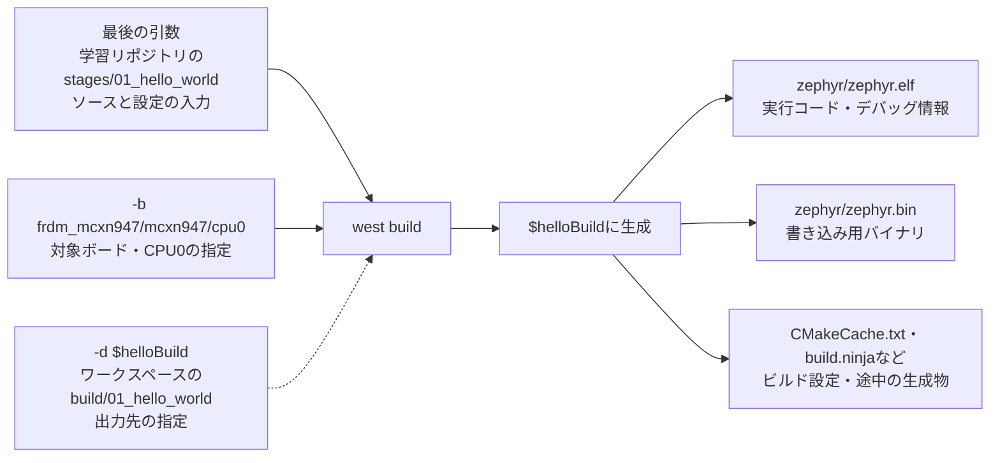
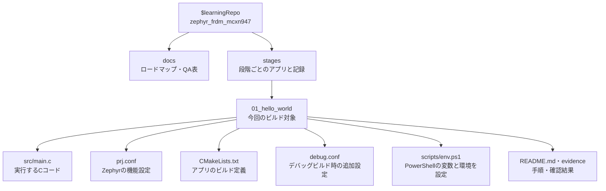
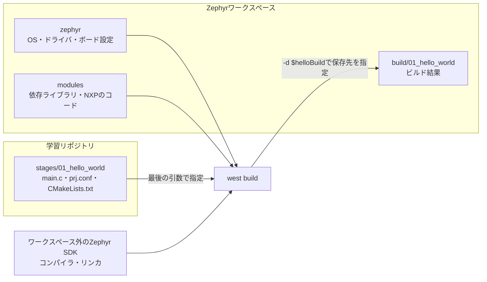
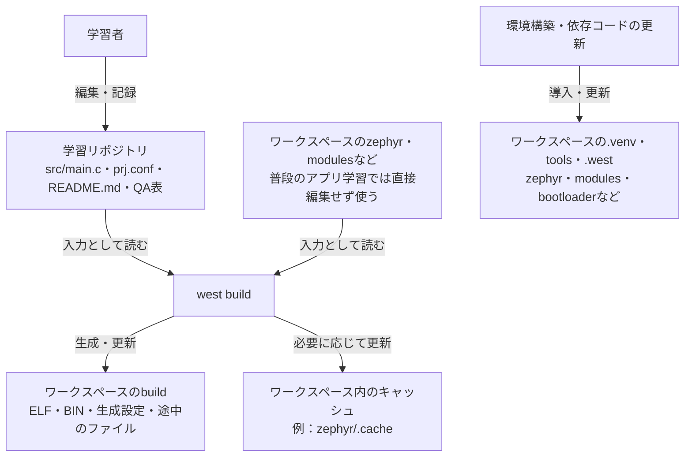
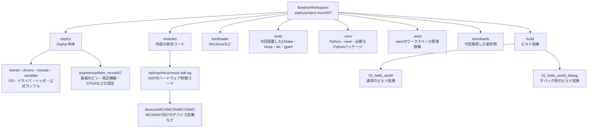
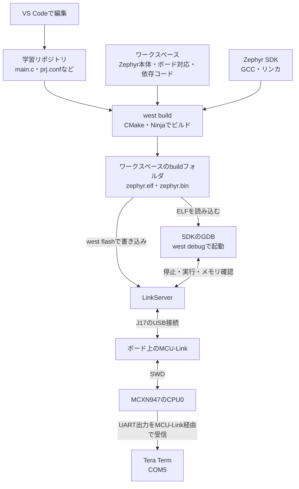

# Zephyr学習プロジェクト QA表

FRDM-MCXN947でZephyrを学ぶ過程で、ユーザーが質問し回答した内容を段階別に記録する。操作結果の報告は各段階のREADMEに残し、この表には疑問点とその回答を残す。

## 記録方針

- 日時は日本時間（Asia/Tokyo、JST、UTC+09:00）で記載する。
- 今回の過去分は、会話履歴の各質問に対応するターン開始時刻を「質問日時」欄に使用した。メッセージ送信時刻そのものは取得できていないため、両者を区別する。
- 質問・回答は意味を保って要約する。同じ質問に複数の論点がある場合は、同じ日時の別行に分ける。
- 表の回答だけでは理解しにくい内容には、欄外に図・具体例・補足説明を付け、回答欄からリンクする。会話で示した理解に役立つ図も記録に残す。
- 段階0より前の質問は「段階0前」と記載する。進捗への回答は質問当時の状態として読む。
- 今後も回答した質問を追記し、段階・質問日時・カテゴリ・質問内容・回答を残す。正確な日時を確認できない場合は不明または代替時刻の種類を明記し、記録した時刻を質問時刻として流用しない。

## QA一覧

| ID | 質問した段階 | 質問日時（JST、ターン開始時刻） | 質問のカテゴリ | 質問内容 | 回答 |
|---|---|---|---|---|---|
| QA-001 | 段階0前：学習計画 | 2026-10-10 16:54:47 | 学習計画 | FRDM-MCXN947でZephyrを段階的に学ぶため、提示した課題より効率的な学習手順はありますか？ | 段階0〜15の計画を提案。Hello Worldの後にGPIO・LED点滅・スレッドとキュー・UART・NT-Shellを学び、メモリ操作をRAMと周辺レジスタに分ける。LCD・カメラ・Slintは単体で確認してから組み合わせる。各段階で動くコード、手順、期待動作、本人の確認結果を残す。詳細は[ロードマップ](roadmap.md)。 |
| QA-002 | 段階0前：進め方 | 2026-10-10 17:12:53 | チャット運用 | 段階ごとにチャットを分けたほうがよいですか？ | このプロジェクトでは1段階＝1チャットを基本とし、同じ段階の途中は同じチャットを使う。全体計画の相談と段階ごとの実習を分け、引き継ぎにはイシューとリポジトリ内のREADME・記録を使う。 |
| QA-003 | 段階0／#1 | 2026-10-10 17:28:19 | 進捗・完了条件 | 段階0は終了ですか？ | 質問時点でPC環境調査、使用バージョンの選定、日本語での理由・方針の記録は完了。ツール導入、Hello Worldのビルド・書き込み・デバッグは段階1の作業。この回答時点では#1はまだクローズしていなかった。 |
| QA-004 | 段階1／#2 | 2026-10-10 18:08:20 | 学習方針・イシュー管理 | 私がビルド・実機確認をしないうちに、学習用のイシュー#2をクローズするのはやめてもらえますか？ | Codexの検証だけでクローズした判断を訂正し、#2を再オープンした。Codexの準備・事前検証と本人の実習結果を区別する。本人が完了条件を満たしたことを確認し、クローズを依頼または許可した場合のみ閉じる。 |
| QA-005 | 段階1／#2 | 2026-10-10 20:16:59 | ビルド対象 | 「次は学習リポジトリに置いたHello Worldをビルド」とありますが、これまでは何をビルドしていたのですか？ | それまではZephyr本体の`zephyr/samples/hello_world`にある公式サンプルをビルドしていた。次は同じソースと設定をコピーした学習リポジトリの`stages/01_hello_world`を独立したアプリとしてビルドする。公式サンプルで環境の動作を確認し、その後、編集して学ぶアプリのビルドを確認する順番。 |
| QA-006 | 段階1／#2 | 2026-10-10 21:36:17 | GDB・トラブル対応 | GDBを起動しても`(gdb)`と表示されません。Enterキーを押したほうがよいでしょうか？ | `--Type <RET> for more, q to quit, c to continue without paging--`はページ送りの入力待ち。Enterで次のページ、`c`＋Enterで残りをまとめて表示する。`(gdb)`が出てから`set pagination off`を実行すると、その後のページ送り待ちを無効にできる。LinkServerのログが後から表示されても、GDBがページ送りを待っている場合がある。 |
| QA-007 | 段階1／#2 | 2026-10-10 22:19:09 | ビルドコマンド・PowerShell変数 | `west build`の`-d $helloBuild`は何を意味していますか？ | `-d`はビルド結果の保存先を指定するwestのオプション。`$helloBuild`はenv.ps1で設定したPowerShell変数で、今回の値は`C:\Users\grace\zephyrproject-mcxn947\build\01_hello_world`。ELF・BIN、途中のコンパイル結果、生成設定などがこのフォルダに保存される。 [欄外の保存先とビルドコマンドの図](#qa-007-supplement)を参照。 |
| QA-008 | 段階1／#2 | 2026-10-10 22:19:09 | ビルドコマンド・PowerShell変数 | `$learningRepo`は何を意味していますか？ | 学習リポジトリの場所を入れたPowerShell変数。今回の値は`C:\Users\grace\Documents\ChatGPT\zephyr_frdm_mcxn947`。`"$learningRepo\stages\01_hello_world"`は実行前にアプリの絶対パスへ展開され、ビルド対象のソースと設定の場所としてwestへ渡される。変数名だけをPowerShellで入力すると値を確認できる。 [欄外の学習リポジトリのディレクトリ図](#qa-008-supplement)を参照。 |
| QA-009 | 段階1／#2 | 2026-10-10 22:29:36 | プロジェクト構成・標準方式 | ソースコードとビルド結果の格納場所を分けているのですか？ それがZephyrの標準的な構成ですか？ | 生成物を専用のビルドディレクトリに分けることはZephyrの基本方式。ただし今回のように別の大きなフォルダへ置くことは必須ではなく、アプリ内の`app/build`へ出力する構成も使える。ワークスペースの外に学習アプリを置く今回の方式は、公式に対応したfreestanding application。学習コード・記録のGit管理と、依存コード・生成物の管理を分ける目的で採用した。[公式資料](https://docs.zephyrproject.org/latest/develop/application/index.html)。 [欄外のソースとビルド結果の関係図](#qa-009-supplement)を参照。 |
| QA-010 | 段階1／#2 | 2026-10-10 22:38:35 | 編集範囲・環境管理 | 学習リポジトリにアプリのソースを置き、Zephyrワークスペースではビルド結果だけを追加し、他のファイルを編集しないという理解でよいですか？ | 学習アプリのソースと設定を学習リポジトリに置き、普段はZephyr本体・依存ライブラリを直接編集せずに使う方針。ただしワークスペースではビルド結果以外にも設定・キャッシュ・ログが生成され、環境構築や更新でツール・依存パッケージも追加・更新される。 [欄外の編集・生成・環境管理の区分図](#qa-010-supplement)を参照。 |
| QA-011 | 段階1／#2 | 2026-10-10 22:38:35 | ワークスペース・ボード対応 | Zephyrワークスペースには具体的に何が入っていますか？ Zephyrのソース、ツール、FRDM-MCXN947のコードなどでしょうか？ | `zephyr/`にカーネル・ドライバ・公式サンプル・ボード対応、`modules/`に外部ライブラリやNXPの制御コード、`bootloader/`にMCUboot、`tools/`に関連ツール、`.venv/`にPython環境、`.west/`にwest管理情報、`build/`に生成物、`downloads/`に取得した配布物がある。ボード対応は`zephyr/boards/nxp/frdm_mcxn947`、NXPのMCXN947対応は`modules/hal/nxp/mcux/mcux-sdk-ng/devices/MCX/MCXN/MCXN947`。SDKは別フォルダ。 [欄外のワークスペースのディレクトリ図](#qa-011-supplement)を参照。 |
| QA-012 | 段階1／#2 | 2026-10-10 22:41:39 | 開発環境の全体像 | Zephyr SDK、ワークスペース、学習リポジトリ、開発環境の全体像を教えてください。 | 学習リポジトリは編集するアプリと記録、ワークスペースはZephyr本体・依存コードと今回配置した環境・生成物、SDKはGCC・リンカ・GDBなどの道具。VS Codeで編集し、PowerShellからwestを操作する。west buildはCMake・NinjaとSDKでELF・BINを生成。west flash/debugはLinkServerとMCU-Linkで実機を操作し、Tera TermはCOM5からUARTを受信する。env.ps1がPATH、Zephyr・SDKの場所、各パス変数を設定してこれらを結び付ける。[欄外の構成図と読み方](#qa-012-supplement)を参照。 |
| QA-013 | 段階1／#2 | 2026-10-10 23:05:41 | Git・PR・イシュー管理 | 段階1の確認はOKだと思います。プルリクエストを作成し、イシューをクローズするのが一般的なプロセスですか？ | はい。本人の実習確認後、変更をコミット・pushし、PRで差分と確認結果をレビューしてからマージし、イシューをクローズする流れが適している。PRは変更を確認・取り込むため、イシューは学習課題の完了を追跡するために使う。PR本文に`Closes #2`と書き、既定ブランチへマージすると#2を自動クローズできる。PRを作成しただけでは閉じない。[GitHub公式資料](https://docs.github.com/en/issues/tracking-your-work-with-issues/using-issues/linking-a-pull-request-to-an-issue)。質問時点で本人の確認OKを受け、PR作成・マージとクローズは未実施。 |

## 欄外の補足

### 図で使用するパス

以下は今回の実習環境のパス。図では読みやすくするため「学習リポジトリ」「ワークスペース」などの名称で示す。

| 図の名称・変数 | 今回の絶対パス | 役割 |
|---|---|---|
| 学習リポジトリ：`$learningRepo` | `C:\Users\grace\Documents\ChatGPT\zephyr_frdm_mcxn947` | 自分のアプリ、学習手順、QAを保存する |
| 学習アプリ | `C:\Users\grace\Documents\ChatGPT\zephyr_frdm_mcxn947\stages\01_hello_world` | Hello Worldのビルド入力 |
| ワークスペース：`$zephyrWorkspace` | `C:\Users\grace\zephyrproject-mcxn947` | Zephyr本体、依存コード、今回配置したツールとビルド結果 |
| 通常ビルド：`$helloBuild` | `C:\Users\grace\zephyrproject-mcxn947\build\01_hello_world` | 通常のビルド結果を保存する |
| デバッグビルド：`$helloDebugBuild` | `C:\Users\grace\zephyrproject-mcxn947\build\01_hello_world_debug` | デバッグ用の設定で作ったビルド結果を保存する |
| Zephyr SDK | `C:\Users\grace\zephyr-sdk-1.0.1` | コンパイラ、リンカ、GDBなど |

<a id="qa-007-supplement"></a>

### QA-007：`-d $helloBuild`とビルド結果の保存先

実習で使ったコマンドを、入力と出力に分けて見る。

```powershell
west build -p always -b frdm_mcxn947/mcxn947/cpu0 `
    -d $helloBuild "$learningRepo\stages\01_hello_world"
```



`-d`は保存先を選ぶ指定で、ソースの場所は最後の引数で指定する。`-p always`は、指定したビルドディレクトリの既存の生成物を消してから作り直す指定。上のコマンドは説明用の再掲なので、図を読むために再実行する必要はない。

確認するときはPowerShellで`$helloBuild`の値を表示し、そのフォルダの中に`zephyr\zephyr.elf`や`zephyr\zephyr.bin`ができているかを見る。

<a id="qa-008-supplement"></a>

### QA-008：`$learningRepo`から学習アプリまでの位置関係

`$learningRepo`は学習リポジトリ全体の場所。`stages\01_hello_world`を付け足すと、今回ビルドするアプリの場所になる。線はフォルダの親子関係を示す。



PowerShellの二重引用符の中では変数が展開される。`"$learningRepo\stages\01_hello_world"`は、上のパス表にある「学習アプリ」の絶対パスになる。`$learningRepo`そのものを指定すると、アプリより上のリポジトリ全体を指してしまう。

`$learningRepo`と`"$learningRepo\stages\01_hello_world"`をそれぞれPowerShellで表示すると、どこまでを変数に入れ、どこを付け足したか確認できる。`debug.conf`はファイルを置くだけでは追加されず、デバッグ用ビルドで指定して使う。

<a id="qa-009-supplement"></a>

### QA-009：ソースとビルド結果を分ける今回の構成

この図の線はフォルダの親子関係ではなく、ビルドに使う入力と生成物の流れを示す。



アプリのソースとビルド結果は別のフォルダにあり、ビルドでは自分のアプリとZephyr側のコードを組み合わせる。学習リポジトリを編集しても、生成物の保存先は`-d`の指定に従う。

ソースと生成物を分けるために、今回の2つのルートフォルダへ分割することまでは必須ではない。アプリ内に専用の`build`フォルダを作る配置も使える。今回は、自分が管理する学習コード・記録と、Zephyrの依存コード・生成物を分けるためにこの配置を選んだ。

<a id="qa-010-supplement"></a>

### QA-010：普段編集するものと、ビルドや環境管理で変わるもの

矢印のラベルは「誰が、どのように扱うか」を示す。



普段の実習では、自分のアプリと学習記録を編集する。一方、ワークスペースはビルド結果を保存するだけの場所ではなく、ツールや依存コードも持つ。ビルドでキャッシュが更新され、環境構築や更新で依存コード・Pythonパッケージなどが変わることもある。

したがって「Zephyr本体や依存ライブラリを普段は直接編集しない」が今回の方針。「ワークスペースではビルド結果以外は一切変わらない」という意味ではない。

<a id="qa-011-supplement"></a>

### QA-011：ワークスペースの中身とFRDM-MCXN947のコード

以下は実際のワークスペースの主要フォルダ。線はフォルダの親子関係を示し、深い階層は途中を省略して1つの枠にまとめている。`tools`・`downloads`・`.venv`などの配置は今回の環境構築で選んだもの。



FRDM-MCXN947のボード設定と、MCXN947というチップを制御するNXPのコードは別の場所にある。ボード設定は「この基板でどのピン・周辺機器を使うか」、NXP側のコードは「チップのハードウェアをどう制御するか」をビルドに提供する。

ワークスペースに存在するコードすべてをHello Worldに組み込むわけではなく、対象ボードと機能設定に必要なものをビルドで選ぶ。たとえば`bootloader`にMCUbootのコードがあっても、今回のHello WorldでMCUbootを使っているという意味ではない。

Zephyr SDKはこのツリーの外に置いている。NXPの`mcux-sdk-ng`はチップ制御のコード、Zephyr SDKはGCC・リンカ・GDBなどの道具という違いがある。


<a id="qa-012-supplement"></a>

### QA-012：開発環境の構成図と読み方

ソースコードを編集してから、ビルド・書き込み・デバッグ・UART出力の確認までの関係を示す。以下は今回の実習環境の構成で、ビルド結果はワークスペースの`build`フォルダに保存する。



図は次の順に読む。

1. **ビルド**：自分のアプリとZephyrのコード・ボード設定を入力にし、SDKのコンパイラとリンカで実行ファイルを作る。CMakeがビルド手順を生成し、Ninjaがその手順を実行する。
2. **書き込みとデバッグ**：LinkServerがUSB接続のMCU-Linkを操作し、MCU-LinkがSWDというデバッグ用の接続でCPU0を操作する。GDBはELF内のソース位置・変数の情報を使い、LinkServerを通してブレークポイントやステップ実行、メモリ確認を行う。
3. **表示の確認**：CPU0で実行した`printf`のUART出力は、MCU-Linkの仮想COMポートを通ってTera Termに届く。今回のCOMポートはCOM5。Tera Termは出力を読む役割で、ビルドや書き込みは行わない。

## 関連する記録

- [学習ロードマップ](roadmap.md)
- [段階0の選定記録](../stages/00_versions/versions.md)
- [段階1の手順と本人の実習結果](../stages/01_hello_world/README.md)
