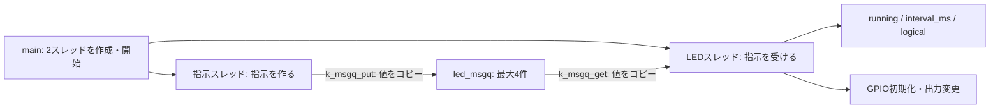

# 段階4：スレッドとメッセージキューでLEDを制御する

対象：[イシュー #5](https://github.com/grace2riku/zephyr_frdm_mcxn947/issues/5)。前提：[段階3](../03_led_blink/README.md)。
準備日：2026-10-11（JST）。作業ブランチ：`codex/stage4-threads-queues`。

## 目的と現在の状態

段階3ではmainスレッドがLED操作・表示・待機を繰り返した。
段階4ではmainが2つのスレッドを開始し、指示スレッドが開始・停止・切り替え間隔変更を
メッセージキューで送り、LEDスレッドが受信した指示を反映する。

開始時の学習リポジトリは変更のないmain、HEADは`fb75b805fde915cbedf705e7b1c95db8c9eb8a74`。
PR #20のマージとイシュー #4のcompletedでのクローズをCodexがGitHubで確認した。
開始時のボードは段階3の250 ms版という本人の引き継ぎ報告に基づく。

本人の環境設定・Zephyrコミット・ブランチ作成の確認まで完了。
Codexが段階4のソースと設定を作成した。本人は先頭40行の指示データ・キュー定義を確認済み。
本人はLEDスレッドの入口・受信待機（71〜115行）と指示反映（117〜154行）も確認済み。
本人は指示スレッドの送信・待機（156〜199行）も確認済み。
本人はスタック・制御ブロック、main、prj.confも確認済み。
本人は補助関数とCMake設定まで表示して確認済み。
本人用ビルドは終了コード0で成功。書き込み前にCOM5とプローブHN2APUBRDCEPTを本人が再確認済み。
本人による段階4の書き込みは成功表示と終了コード0で確認済み。
本人は最初の1巡のUARTと赤色LEDを確認し、低速→高速→消灯→高速再開→消灯の目視結果を報告した。
提供UARTではseq 3〜18の受信・状態更新と継続動作を確認。
続いて本人が3巡の目視確認、seq 25までのUART進行、ERRORなし・set_retすべて0を報告した。
この追加確認は本人の報告に基づき、追加UARTログ自体は未受領。
本人による役割分担・状態更新担当・待機・優先度・スタックの説明を確認済み。
本人がREADMEと実際の学習・観察結果の一致を確認し、段階4のPR作成を依頼した。[PR #21](https://github.com/grace2riku/zephyr_frdm_mcxn947/pull/21)を作成し、本人が内容に問題がないと確認した。マージ・クローズは別途承認待ち。
Codexのビルド確認は[evidence/README.md](evidence/README.md)へ別に記録する。
後続操作は結果をチャットで共有し、確認してから一つずつ進める。

## 学習に使用したAIモデル

| 利用期間（JST） | AIツール | AIモデル（モデルID） | AIモデルバージョン | 推論設定 | 確認根拠 |
|---|---|---|---|---|---|
| 2026-10-11〜（段階4の学習継続中） | OpenAI Codex（デスクトップ） | 未確認 | 未確認。固定スナップショットIDは未取得 | 未確認 | 本段階の設定画面・保存済みメタデータによる確認は未実施。過去の段階の値を流用しない |

[AIモデルの記録方針](../../docs/ai-models.md)に従う。確認できた情報だけを追記し、
チャット本文やセッションログ全体はリポジトリへコピーしない。

## 使用環境と接続

段階0〜3の固定環境を継続する。下表は採用版であり、段階4での実測結果とは区別する。
詳細は[使用バージョンの記録](../00_versions/versions.md)。

| 項目 | 採用するもの |
|---|---|
| PC／シェル | Windows 11ネイティブ／PowerShell 7.6.5（本人が今回も確認） |
| ボード／ターゲット | FRDM-MCXN947／`frdm_mcxn947/mcxn947/cpu0`、内蔵Flash |
| Zephyr | 4.4.2／`dccb09599635bdff17633fa7e9dab014b91dce90`（本人が今回もSHAを確認） |
| SDK／GCC／GDB | 1.0.1／14.3.0／16.2 |
| Python／west | 専用venvの3.12.10／1.5.0（westは本人が今回も確認） |
| CMake／Ninja／gperf／DTC | 3.31.8／1.13.1／3.1／1.6.1 |
| LinkServer | 1.4.85 |
| プローブ | MCU-LINK FRDM-MCXN947 (r0E7)、CMSIS-DAP V3.128、シリアル`HN2APUBRDCEPT`。段階4の書き込み前に本人が再確認済み。後の各書き込み前にも再確認 |
| UART／端末 | COM5・MCU-Link VCom Port (COM5)を本人が再確認済み／115200 baud・8N1・フロー制御なし／Tera Term 5.4.0。本人からUARTログを受領済み |
| 本人用ビルド先 | `C:\Users\grace\zephyrproject-mcxn947\build\04_threads_queues` |
| Codex用ビルド先 | 学習リポジトリの`.tmp/build/04_threads_queues_codex`（Git管理対象外） |

USBはJ17へ接続。追加配線は不要。`led0 → red_led`、GPIO0のピン10（PIO0_10）、
`GPIO_ACTIVE_LOW`を引き継ぐ。コネクターの10番端子という意味ではない。
論理1は物理Lowで点灯、論理0は物理Highで消灯する期待値。電圧は未測定。
CPU0用のボード定義で必要な情報がそろうため、独自overlayは追加しない。

## アプリの構成

```text
04_threads_queues/
├── CMakeLists.txt
├── prj.conf
├── README.md
├── src/main.c
├── evidence/        # Codexのビルド確認。本人の実習とは区別する
└── user-evidence/   # 本人が提供したビルド・実機確認などのログ
```

`CMakeLists.txt`は段階3からプロジェクト名を変更。
`prj.conf`はGPIO・printk・UARTコンソールを継続し、MULTITHREADING、
mainの優先度0とスタック要求サイズ2048 Bを明示する。
UARTの受信操作は後の段階で学ぶ。今回はソース内の指示列を自動で繰り返す。

command_nameは指示の種類をUART表示用の文字列へ変換する補助関数。
STARTなどの指示そのものを処理する関数ではない。
set_ledはgpio_pin_set_dtで出力を設定し、経過時間・理由・GPIO APIの戻り値・要求した論理値を表示して、
GPIO APIの戻り値を呼び出し元へ返す。呼び出すのはLEDスレッドだけ。
running・interval_ms・状態変数logicalの更新は、呼び出し元のled_entryが担当する。
expectedは要求した期待動作であり、失敗時も実際にその状態になったという測定結果ではない。

find_package(Zephyr ...)はZephyrのビルド設定を読み込み、project(threads_queues)はCMakeのプロジェクト名を設定する。
target_sources(app PRIVATE src/main.c)は段階4フォルダを基準にmain.cをappのコンパイル対象へ追加する。
main.cのファイル内の入口関数を使って2スレッドを作るので、スレッドごとの別ソースファイルは必須ではない。

### スレッドの役割・優先度・スタック

| スレッド | 役割 | 優先度 | スタック要求サイズ | 待機／終了 |
|---|---|---|---|---|
| main | 起動表示、2スレッドの作成・開始 | 0（prj.conf） | 2048 B（prj.conf） | 準備後にreturn。追加スレッドは継続 |
| LED | GPIO初期化、指示受信、LED出力と点滅状態の更新 | 5 | 2048 B（LED_STACK_SIZE） | 停止中は指示まで待機、点滅中は指示かタイムアウトまで待機 |
| 指示 | 自動操作の指示を送信 | 6 | 2048 B（COMMAND_STACK_SIZE） | キュー満杯時は最大1秒待機、操作間はk_msleep |

Zephyrでは数値が小さいほうが高い優先度。今回の0・5・6はプリエンプティブ優先度。
LED側を指示側より高くし、受信可能になったらLED処理を実行しやすくする。
待機中のスレッドは実行対象にならないため、優先度が高くてもCPUを使い続けない。
優先度は点滅周期を指定する値ではない。

スタックは関数呼び出し・ローカル変数などに使うスレッドごとのメモリ。
2048 Bは初期の要求サイズで、実行時の最大使用量の測定結果ではない。
マクロによる整列・保護領域、制御ブロックなどもあり、RAM使用量は3×2048 Bだけでは決まらない。
`k_thread_create`には`K_THREAD_STACK_SIZEOF`を渡し、通常のsizeofで代用しない。

### スタックと制御ブロックの準備・mainでの開始

K_THREAD_STACK_DEFINEはスレッドのスタック領域を、対象CPUに必要な整列などを満たす形で用意する。
led_stackとcommand_stackは別々の領域。mainのスタックはCONFIG_MAIN_STACK_SIZEで別に設定する。
`static struct k_thread led_thread`などはカーネルがスレッドの状態・優先度などを管理する制御ブロック。
スタック領域とは別のもの。ファイルスコープに用意しているので、mainが終了しても保存領域は残る。

mainの起動表示の後、次のようにLEDスレッドを作成する。指示スレッドも同じ形式。

```c
k_thread_create(&led_thread, led_stack, K_THREAD_STACK_SIZEOF(led_stack),
                led_entry, NULL, NULL, NULL, LED_PRIORITY, 0, K_FOREVER);
```

| 引数 | 今回の値の意味 |
|---|---|
| &led_thread | スレッド制御ブロックの場所 |
| led_stack | このスレッド用のスタック領域 |
| K_THREAD_STACK_SIZEOF(led_stack) | APIへ渡すスタックサイズを専用マクロで取得 |
| led_entry | スレッドで実行する入口の関数。ここでは通常の関数呼び出しとして実行しない |
| NULL, NULL, NULL | 入口関数へ渡すp1・p2・p3。今回は引数を使わない |
| LED_PRIORITY | 優先度5 |
| 0 | 追加のスレッドオプションなし |
| K_FOREVER | 作成時には実行開始させず、明示的な開始を待つ |

最後のK_FOREVERはk_msgq_getの受信待機ではなく、k_thread_createの開始遅延指定。
2スレッドを作成してからk_thread_startで実行可能にする。
k_thread_startを呼んだことは、入口関数がその場で実行し終わったことを意味しない。

今回のmainは優先度0で、追加スレッドの5・6より高い。
この短い準備処理には待機がないため、2スレッドを実行可能にした後もmainが進み、returnで終了する。
その後LEDスレッド（5）が実行され、GPIO初期化を行って停止中の受信待機へ入る。
続いて実行可能な指示スレッド（6）が選ばれ、指示を送る。
指示によってLED側の待機が解除されると、優先度5のLED処理が優先される。
割り込みなどの他のシステム処理を含めた厳密な時刻・実行履歴は実機未測定。

mainを含む3つのアプリスレッドはCPU0で実行される。CPU1を使う構成にはしていない。
それぞれ独立した処理の流れを持ち、待機や優先度に応じてCPUを使う処理が切り替わる。
mainのreturnはmainスレッドの終了であり、アプリ全体や開始した追加スレッドの終了ではない。

### 指示データとキュー

`enum led_command_type`でSTART・STOP・SET_INTERVALを区別する。
`struct led_command`は種類、切り替え間隔（ms）、UART確認用の指示番号をひとまとめにする。
START／STOPではinterval_msを0にするが、その値を間隔へ反映する処理は行わない。

```c
K_MSGQ_DEFINE(led_msgq, sizeof(struct led_command), 4, 1);
```

このマクロはキュー本体と保存領域を定義・初期化する。
1件のサイズは構造体のsizeof、未受信の保存上限は4件、最後の1は保存領域のアラインメント。
キューはスレッドではなく、指示データを受け渡すカーネルのオブジェクト。

`k_msgq_put`が送信側の構造体から値をコピーし、`k_msgq_get`が受信側の構造体へコピーする。
送信側のローカル変数へのポインタをキューの内容として渡す方式ではない。
API引数の`&command`はコピー元／コピー先の場所を指定する。
受信待ちのスレッドがあれば直接コピーされる場合もあり、必ず保存領域を経由するわけではない。

### 状態を更新する担当



running・interval_ms・logicalはLEDスレッドのローカル変数で、LEDスレッドだけが更新する。
指示番号は指示スレッドが更新し、指示にコピーする。
GPIOの準備状態確認・初期消灯設定・出力変更もすべてLEDスレッドが行う。
mainと指示スレッドはLED出力を直接操作しない。
共有するキューの内部状態の同期はカーネルが行う。この構成ではLED状態用のmutexは不要。

### 受信待ちと点滅

led_entryはLEDスレッドの開始時に呼ばれる関数。
引数p1〜p3はスレッド作成APIの共通形式で、このアプリでは使わないためARG_UNUSEDを付ける。
初期値はrunning=false（点滅停止）、logical=0（論理消灯）、interval_ms=500。
GPIO初期化を終えてから、次の処理を繰り返す。

```c
k_timeout_t timeout = running ? K_MSEC(interval_ms) : K_FOREVER;
ret = k_msgq_get(&led_msgq, &command, timeout);
```

`条件 ? 真の場合 : 偽の場合`という条件演算子で、点滅中と停止中の待機を選ぶ。
k_timeout_tはZephyrのタイムアウト指定を表す型。
K_MSECはmsからタイムアウト指定を作り、K_FOREVERは時間制限なしの待機を指定する。

k_msgq_getの3引数は受信するキュー、コピー先の構造体の場所、最大待機時間。
キューに指示があれば待たずに受け取る。空なら、指示が届くか指定時間が満了するまでスレッドが待つ。
停止中のK_FOREVERも、指示が届けば受信して再開する。停止中にON/OFFの反転は行わない。

戻り値0ならcommandに有効な指示が入り、後ろのswitchで処理する。
点滅中の-EAGAINは指定時間内に指示が届かなかったことを意味し、このアプリでは
予定したON/OFF切り替えのきっかけとして扱う。受信した指示としてcommandを読んではいけない。
`!logical`で次の論理値を選び、set_ledがGPIO設定とUART表示を行う。
GPIO設定に成功してからlogicalを更新し、continueでwhileの次の反復へ進む。
それ以外の受信異常はエラーを表示してスレッドを終了する。

例えば点滅中・間隔500 msで受信待ちに入り、200 ms後にSTOPが届けば、
残り300 msを待ち切らずSTOPを受信して消灯する。厳密な200 msでの反映を保証する意味ではなく、
受信後のGPIO処理やスケジューリング時間は別にかかる。
この200 msは説明用の仮定で、実機で測定した結果ではない。

| 状態／処理 | 使用する待機 | 待機が終わった後 |
|---|---|---|
| LED停止中 | k_msgq_getのK_FOREVER | 指示を受けて処理 |
| LED点滅中 | k_msgq_getのK_MSEC(interval_ms) | 指示なら指示を処理。-EAGAINならON/OFFを反転 |
| 指示送信時、キュー満杯 | k_msgq_putのK_MSEC(1000) | 空きができれば送信。失敗はエラーを表示して指示スレッド終了 |
| 指示の間の保持時間 | k_msleep(hold_ms) | 次の指示へ進む |

受信待ちをループで何度も試す構成にしない。待機中はCPUを他の実行可能なスレッドやアイドルへ譲る。
点滅中はk_msleepでLEDスレッドを寝かせず、受信のタイムアウトを切り替え時刻として使うため、
次の切り替え時刻より先に指示が届けばその指示を処理できる。
これは厳密な応答時間・CPU使用率の測定結果ではない。

STARTは停止中なら直ちに論理1にして点滅開始。点滅中のSTARTは状態を維持する。
STOPは論理0にして点滅停止。スレッドは終了せず、次の指示を待つ。
SET_INTERVALは100〜2000 msの範囲だけ受け付け、現在のON/OFFは変えない。
停止中にも間隔を設定でき、次のSTARTで使う。

各指示の処理後、次の受信待ちを新しい間隔で開始する。
点滅中の重複STARTや不正指示でも待機は開始し直すため、以前の切り替え予定時刻を保持する設計ではない。
指示を絶えず送ると切り替えが遅れることがある。今回の自動指示列は間に待機を入れる。
GPIOやキューAPIの異常は表示して担当スレッドを終了する。異常後の自動復旧は実装しない。

### switchによる指示の反映

受信成功時だけ、RX行を表示して`switch (command.type)`へ進む。
switchは指示の種類と一致するcaseを選ぶ。breakはswitchを抜ける指定で、外側のwhileは終了しない。
GPIO異常時のreturnはled_entry全体を終了するため、breakとは意味が異なる。

| 指示 | GPIO操作 | 状態変数の更新 | 次の受信待機 |
|---|---|---|---|
| START（停止中） | set_led(1, "START")で点灯 | 成功後にlogical=1、running=true。interval_msは保持 | 現在の間隔を上限として待つ |
| START（点滅中） | 変更しない | running・logical・interval_msは保持 | 現在の間隔で待ち直す |
| STOP | set_led(0, "STOP")で消灯 | 成功後にlogical=0、running=false。interval_msは保持 | K_FOREVERで次の指示を待つ |
| SET_INTERVAL（100〜2000 ms） | 変更しない | interval_msだけ更新。running・logicalは保持 | 点滅中なら新しい間隔、停止中ならK_FOREVER |
| 範囲外の間隔／未知の種類 | 変更しない | 3つの状態変数は保持。REJECTを表示 | 現在の状態に応じて待ち直す |

STARTの`if (!running)`は「停止中だけ開始処理をする」という条件。
点滅中に再度STARTが来ても、現在のON/OFFを強制的に点灯へ変えない。
STOPは停止中でも消灯を再設定し、そのまま次の指示を受け付ける。
START／STOPの指示のinterval_ms=0は、この2つのcaseでは間隔の変更に使わない。

SET_INTERVALでは`値 < 最小値 || 値 > 最大値`を範囲外として拒否する。
`||`は「どちらかの条件が成り立つ」を意味する。100と2000は受け付ける。
値を範囲内へ丸める処理ではなく、範囲外なら以前の設定を維持する。
例えば500から250へ変更しても、その瞬間のGPIO出力は変わらず、次の受信待機を250 msで開始する。
停止中なら新しい設定だけ保存し、次のSTART時に使う。

switchの後にSTATE行を表示し、whileの先頭へ戻ってtimeoutを選び直す。
STATE行のnominal_period_msはinterval_msの2倍で、停止中にも設定上の値を表示する。
状態更新とGPIO操作はすべてLEDスレッドが担当し、指示スレッドは指示の値だけを送る。

### 指示スレッドの送信と待機

command_entryは指示スレッドの開始時に呼ばれる関数。
scriptは自動操作の配列で、各項目は指示の種類、変更する間隔、送信後の待機時間（hold_ms）。
static constでこの操作列を保存し、実行中に変更しない。
例えば`{LED_CMD_START, 0, 4000}`はSTARTを送り、その後指示スレッドが4秒待機する。
START／STOPの間隔欄の0はLED側で間隔変更に使わず、既存の設定を保持する。

whileが操作列全体を繰り返し、内側のforがscriptを先頭から1件ずつ選ぶ。
ARRAY_SIZE(script)は配列の要素数で、今回8件。iは0〜7を取り、++iで次へ進む。
sequenceはwhileの外で初期化するため、2巡目も9・10…と指示番号が続く。
uint32_tなので最終的には桁あふれして0へ戻る。無期限に増え続ける整数ではない。

各反復でstruct led_commandを作り、typeとinterval_msを選んだ項目からコピーする。
`++sequence`は番号を1増やしてから代入するため、最初の指示番号は1。
`.type = ...`などは、構造体の各メンバーを名前で指定する初期化。
hold_msは送信する構造体には含めず、指示スレッド自身の待機にだけ使う。

```c
int ret = k_msgq_put(&led_msgq, &command, K_MSEC(1000));
```

引数は送信先のキュー、コピー元の構造体の場所、最大待機時間。
受信待ちのLEDスレッドがいる場合は指示を渡し、そうでなくてもキューに空きがあれば保存する。
キュー満杯の場合だけ、空きができるまで最大1秒待機してCPUを譲る。
K_MSEC(1000)は各送信で必ず1秒待つ意味ではない。
戻り値0は指示を渡せたことを意味し、LED側のGPIO操作完了を確認する応答ではない。
戻り値が0以外ならエラーを表示し、指示スレッドを終了する。成功するまで無限再試行しない。

送信成功後にhold_msが正ならk_msleepで指示スレッドだけを待機させる。
この間、LEDスレッドは別に受信・タイムアウト・GPIO操作を続けられる。
例えばSTART後の4秒は、指示スレッドの次の指示までの待機であり、LEDのON時間4秒ではない。
LEDのON/OFF間隔はLEDスレッドのinterval_msで決まる。
hold_msが0ならこのsleepを行わず次の項目へ進む。
今回の操作列には4秒・2秒の待機が入るため、操作列全体を休みなく送り続ける構成ではない。

待機開始は送信成功後で、LED側の処理完了から正確に4秒／2秒を測る方式ではない。
1巡の保持時間合計16秒も指定値の合計であり、実際の巡回時間は処理時間等を含む。

## 期待する動作

以下の8指示を繰り返す。1巡の指定保持時間は合計16秒で、実際には処理時間等も含まれる。

| 1巡内の順番 | 指示 | 送信後の指定待機 | 期待動作 |
|---|---|---|---|
| 1 | SET_INTERVAL 500 | なし | 停止中に500 msへ設定 |
| 2 | START | 4秒 | ON/OFF切り替え間隔500 ms、名目周期1000 msで点滅 |
| 3 | START（重複） | なし | 点滅を維持 |
| 4 | SET_INTERVAL 250 | 4秒 | 点滅中に切り替え間隔250 ms、名目周期500 msへ変更 |
| 5 | STOP | 2秒 | 消灯して待機 |
| 6 | STOP（重複） | なし | 消灯を維持 |
| 7 | START | 4秒 | 250 ms間隔で再開 |
| 8 | STOP | 2秒 | 消灯して待機。次の巡へ |

起動時は`Stage 4: threads and message queue`、GPIO準備true、初期設定0を期待する。
RX行は指示番号seq・指示の種類・値、STATE行は反映後の状態。
LED行はGPIO設定直後のソフトウェア時刻・理由・戻り値・要求した論理値を示す。
set_ret=0はAPI成功、expectedは実機で確認する期待値であり、光の測定ではない。
nominal_period_msは点滅中の名目周期。停止中の表示も設定値の2倍を示し、実際に点滅している意味ではない。

UARTのON→次のONの時刻差は約1000 ms／500 msを期待するが、表示・tick・再開タイミング等が含まれる。
指示を挟んだ区間は間隔が開始し直されるため、周期比較には使わない。
少なくとも3巡（seq 1〜24を含む約48秒以上）の開始・停止・間隔変更と指示番号の連続性を確認する。
有限時間の観察を、無期限の動作保証とは扱わない。

## 本人の実習手順

### 操作1：環境設定と使用先を確認（確認済み）

```powershell
$learningRepo = 'C:\Users\grace\Documents\ChatGPT\zephyr_frdm_mcxn947'
. "$learningRepo\stages\01_hello_world\scripts\env.ps1"
$threadsBuild = Join-Path $zephyrWorkspace 'build\04_threads_queues'
Set-Location $env:ZEPHYR_BASE
$PSVersionTable.PSVersion
$env:ZEPHYR_BASE
$threadsBuild
west --version
git -C $env:ZEPHYR_BASE rev-parse HEAD
```

### 操作2：作業ブランチ作成（確認済み）

```powershell
git -C $learningRepo switch -c codex/stage4-threads-queues
git -C $learningRepo status --short --branch
```

これは初回のみ実行する。再開時は既存のブランチへswitchする。

### 操作3：ソースを段階的に読む（本人の表示・確認報告で完了）

まず指示データとキューまでを表示する。

```powershell
Get-Content -Encoding utf8 "$learningRepo\stages\04_threads_queues\src\main.c" -TotalCount 40
```

enumの3種類、structの3項目、K_MSGQ_DEFINEの4引数を確認する。
確認結果と疑問点を共有した後、led_entryの受信・状態更新、command_entryの送信・待機、
mainのスレッド作成・優先度・スタック、設定ファイルの順に読む。
ここでソース全体の確認が完了したとは扱わない。

次にLEDスレッドの入口から受信結果の判定まで（71〜115行）を表示する。

```powershell
Get-Content -Encoding utf8 "$learningRepo\stages\04_threads_queues\src\main.c" | Select-Object -Skip 70 -First 45
```

停止中と点滅中でtimeoutが変わる行、受信成功と時間満了を分ける行を確認する。
確認後、後続のswitchによる開始・停止・間隔変更の反映へ進む。

受信指示の表示、switch、反映後のSTATE表示（117〜154行）を読む。

```powershell
Get-Content -Encoding utf8 "$learningRepo\stages\04_threads_queues\src\main.c" | Select-Object -Skip 116 -First 38
```

START／STOPでinterval_msを変更しないこと、SET_INTERVALでGPIOを操作しないこと、
breakとreturnの違いを確認する。この後に指示スレッドの送信・保持時間へ進む。

指示スレッドの入口・操作列・指示構造体の作成・送信・待機（156〜199行）を表示する。

```powershell
Get-Content -Encoding utf8 "$learningRepo\stages\04_threads_queues\src\main.c" | Select-Object -Skip 155 -First 44
```

interval_msとhold_msの違い、キュー満杯時だけ待つ送信API、待機するのが指示スレッドだけであることを確認する。
確認後、スタック・優先度・mainによるスレッド作成と開始へ進む。

スタックと制御ブロック（42〜45行）、main（201〜219行）、prj.confを順に表示する。
サイズと優先度の定数は先頭40行で読んだ定義を使う。

```powershell
Get-Content -Encoding utf8 "$learningRepo\stages\04_threads_queues\src\main.c" | Select-Object -Skip 41 -First 4
Get-Content -Encoding utf8 "$learningRepo\stages\04_threads_queues\src\main.c" | Select-Object -Skip 200 -First 19
Get-Content -Encoding utf8 "$learningRepo\stages\04_threads_queues\prj.conf"
```

独立したスタックと制御ブロック、作成と開始の違い、mainのreturn後も2スレッドが継続することを確認する。
CMakeLists.txtとGPIO出力用の補助関数の確認後、本人用ビルドへ進む。

最後に補助関数command_name・set_led（47〜69行）とCMakeLists.txtを表示する。

```powershell
Get-Content -Encoding utf8 "$learningRepo\stages\04_threads_queues\src\main.c" | Select-Object -Skip 46 -First 23
Get-Content -Encoding utf8 "$learningRepo\stages\04_threads_queues\CMakeLists.txt"
```

set_ledがGPIO APIの戻り値を返すこと、expectedが実測結果ではないこと、
段階4のmain.cがビルド対象であることを確認する。確認結果を共有してから操作4へ進む。

### 操作4：本人用ビルド（本人のログ・終了コードで確認済み）

ソース・設定の表示確認後に実行する。実行ディレクトリは`$env:ZEPHYR_BASE`。
現在のPowerShellへ操作1の環境設定を読み込んだ状態で実行する。
新しいセッションの場合は操作1を再実行する。

```powershell
Set-Location $env:ZEPHYR_BASE
west build -p always -b frdm_mcxn947/mcxn947/cpu0 -d $threadsBuild "$learningRepo\stages\04_threads_queues"
$LASTEXITCODE
```

Application・ターゲット・生成ELF・終了コード0・Flash/RAMの使用量を確認し、ログを共有する。
`-p always`は指定した段階4用ビルド先の生成物を消して再生成する。

ソースを変更していない場合のCodex事前ビルド値は、FLASH 28,868 B、RAM 9,912 B、SRAMX 0 B。
全体容量に対してFLASH 1.38%、SRAM合計1.89%。CPU0の320 KiB領域に対するRAM使用率は3.02%。
本人から受領した使用量も事前値と一致。本人の結果は実習結果欄に別に記録した。
本人用ビルド先は`C:\Users\grace\zephyrproject-mcxn947\build\04_threads_queues`、
アプリ入力は学習リポジトリのstages/04_threads_queues。Codexの保存先とは異なる。

### 操作5：接続先確認（本人の提示出力で確認済み）

```powershell
Get-CimInstance Win32_SerialPort | Select-Object DeviceID, Name
LinkServer probes --no-boot
```

各書き込み前に実行し、COM番号とプローブのシリアルを共有して確認する。
確認したCOMへTera Termを115200 baud・8N1・フロー制御なしで接続する。

### 操作6：本人による書き込み（成功表示・終了コード0を確認済み）

接続先確認後、シリアルがHN2APUBRDCEPTである場合のコマンド。

```powershell
west -v flash -d $threadsBuild -r linkserver --probe HN2APUBRDCEPT
$LASTEXITCODE
```

Flash書き込み成功表示、終了コード、後続の実機動作で判断する。
Failed to boot probesやUnicodeDecodeErrorが出た場合は後続ログも確認する。
プローブのファームウェア更新は行わない。Codexは書き込まない。

### 操作7：UART・LED・繰り返しを確認（本人の3巡の確認報告を受領済み）

Tera Termの受信準備後にRESETを押して離す。
まず起動表示と最初の1巡（seq 1〜8、約16秒）のRX／STATE／LED行、赤色LEDの目視結果を共有する。
起動・1巡目の結果を確認してから、繰り返し動作の確認へ進む。
最初の提供ログには起動表示とseq 1〜2が含まれていないため、次は受信・記録を開始してからRESETを押して離す。
起動表示からseq 25のSTATEまで（約50秒）を記録し、3巡分のRX／STATE／LED行と赤色LEDの目視結果を共有する。
seq 1〜8が1巡目、9〜16が2巡目、17〜24が3巡目。seq 25は3巡目の最後の消灯待機を終え、4巡目へ進んだ目印。
低速→高速→消灯→高速で再開→消灯が繰り返されることを確認する。
指示を挟まない低速・高速区間でONから次のONの時刻差を比較する。
UARTとLEDの対応を判別できない場合は、推測で確認済みにしない。

### 操作8：理解・記録・PR確認（本人の確認完了、マージ・クローズ承認待ち）

各スレッドの役割、優先度、スタック、送信／受信時の待機、LED状態の更新担当を自分の言葉で説明する。
まずmain・指示スレッド・LEDスレッドの役割と、running・logical・interval_msを更新する担当を確認する。
その回答を確認してから、キューの送受信・待機、優先度・スタックの理解確認へ進む。
本人の実機結果・問題と対処・未確認事項をREADMEへ反映し、本人が確認してからPRを作成する。
マージとイシュー #5のクローズは本人の別途の明示的な承認後に行う。
段階3の承認は段階4へ引き継がない。

## 本人の実習結果

| 報告受領日（JST） | 操作 | 確認結果 |
|---|---|---|
| 2026-10-11（操作日時は未取得） | 環境設定・使用先確認 | PowerShell 7.6.5、ZEPHYR_BASEとthreadsBuildの絶対パス、west 1.5.0が期待値と一致。本人の提示出力を確認 |
| 2026-10-11（操作日時は未取得） | Zephyrコミット確認 | 本人のgit出力がdccb09599635bdff17633fa7e9dab014b91dce90と一致 |
| 2026-10-11（操作日時は未取得） | 作業ブランチ作成 | switch -cの成功と、statusのcodex/stage4-threads-queues・変更なしを本人の提示出力で確認 |
| 2026-10-11（操作日時は未取得） | ソース先頭40行の読み出し | 本人から表示・確認済みの報告を受領。指示データ・キュー定義までの確認として記録。表示内容自体の貼り付けはなく、本人の報告に基づく |
| 2026-10-11（操作日時は未取得） | LEDスレッドの入口・受信待機（71〜115行） | 本人から表示・確認済みの報告を受領。表示内容自体の貼り付けはなく、本人の報告に基づく。本人による状態更新担当などの説明確認はまだ未実施 |
| 2026-10-11（操作日時は未取得） | LEDスレッドの指示反映（117〜154行） | 本人から表示・確認済みの報告を受領。表示内容自体の貼り付けはなく、本人の報告に基づく。本人による状態更新担当などの説明確認はまだ未実施 |
| 2026-10-11（操作日時は未取得） | 指示スレッドの送信・待機（156〜199行） | 本人から表示・確認済みの報告を受領。表示内容自体の貼り付けはなく、本人の報告に基づく。実機での指示反映・繰り返し確認はまだ未実施 |
| 2026-10-11（操作日時は未取得） | スタック・制御ブロック（42〜45行）、main（201〜219行）、prj.conf | 案内した3か所について本人から「確認しました」と報告を受領。表示内容自体の貼り付けはなく、本人の確認報告に基づく |
| 2026-10-11（操作日時は未取得） | 補助関数（47〜69行）とCMakeLists.txt | 本人から表示・確認済みの報告を受領。入力ファイルの読み出し確認は完了。表示内容自体の貼り付けはなく、本人の報告に基づく。本人用ビルドへ進む |
| 2026-10-11（操作日時は未取得） | 本人用ビルド | 本人のログ末尾でZephyr 4.4.2、157/157のELFリンク、本人用build/04_threads_queuesの生成先、ターゲットfrdm_mcxn947/mcxn947/cpu0を確認。直後のLASTEXITCODEは0。FLASH 28,868 B、RAM 9,912 B、SRAMX 0 B、IDT_LIST 0 BでCodexの事前値と一致。提示範囲にエラー表示なし。全ビルドログは未受領。[提供されたログ抜粋](user-evidence/build-excerpt.log)。接続先再確認・書き込み・実機確認は未実施 |
| 2026-10-11（操作日時は未取得） | 書き込み前の接続先再確認 | 本人のシリアルポート列挙でCOM5・MCU-Link VCom Port (COM5)、LinkServer probes --no-bootでプローブ番号1・MCU-LINK FRDM-MCXN947 (r0E7)・CMSIS-DAP V3.128・シリアルHN2APUBRDCEPTを確認。前回と一致し、提示範囲にエラー表示なし。r0E7はプローブの表示として記録し、基板リビジョンとは扱わない。[提供された接続確認ログ](user-evidence/connection.log)。書き込み・UART・LED確認は未実施 |
| 2026-10-11（操作日時は未取得） | 本人によるFlash書き込み | 案内した書き込み操作後の本人ログ末尾でFinished writing Flash successfully、Loaded 0x70C4 bytes、system reset処理、直後のLASTEXITCODE=0を確認。0x70C4＝28,868 Bで本人のビルド値と一致。ロード時間はログ表示280 ms。提示範囲にエラー表示なし。全書き込みログは未受領。[提供されたログ抜粋](user-evidence/flash-excerpt.log)。起動UART・LEDの動作はまだ未確認 |
| 2026-10-11（操作日時は未取得） | 最初の1巡のUART・LED確認 | 本人が最初の1巡のUARTと赤色LEDを確認し、低速点滅→高速点滅→消灯→高速点滅再開→消灯の順に動作したと報告。[提供UART](user-evidence/uart-observation-1.log)はuptime_ms=1060〜33793、RXはseq 3〜18が連続しており、2巡目（seq 9〜16）と3巡目の開始も含む。提示されたLED行のset_retはすべて0、ERROR／REJECT表示なし。起動表示・seq 1〜2は含まれず、最終行のexpectedはOFで途切れているため原文のまま保存。目視の報告範囲は最初の1巡で、3巡の目視確認はまだ未受領 |
| 2026-10-11（操作日時は未取得） | 3巡の繰り返し動作確認 | 本人が3巡とも低速点滅→高速点滅→消灯→高速点滅再開→消灯の順に動作し、途中で停止しなかったと報告。UARTもseq=25まで進み、ERRORなし、set_retはすべて0と報告。観察範囲は3巡（指示列の待機時間合計では約48秒）。追加UARTログ自体は未受領のため、Codexによる当該ログの直接照合とは区別する。無期限の連続動作を確認した結果ではない |
| 2026-10-11（回答日時は未取得） | 役割分担・状態更新担当の理解確認 | 本人がmainは2スレッドの生成・起動、指示側はキュー送信、LED側は受信とLED制御を担当すると説明。running・logical・interval_msはLEDスレッドが更新し、更新担当を1つにすることで当該状態のスレッド間排他制御が不要になると説明できた。指示側の説明に対し、interval_msはON/OFF切り替え間隔で、hold_msは指示側自身の待機時間であり送信しないことをCodexが補足。キューの待機、優先度・スタックの理解確認はこれから行う |
| 2026-10-11（回答日時は未取得） | 送受信・待機の理解確認 | 本人が停止中はK_FOREVER、点滅中はK_MSEC(interval_ms)で受信を待ち、k_msleepで待つのは指示スレッドだけなのでLED側は継続できると説明。k_msgq_putのK_MSEC(1000)は毎回の固定待機ではなく、キュー満杯時の最大1秒の待機と説明できた。Codexが、これらの待機中はCPUを他の実行可能な処理へ譲ることを補足。次は優先度・スタックの理解確認へ進む |
| 2026-10-11（回答日時は未取得） | 優先度・スタックの理解確認 | 本人が数値の小さい方が高優先度で、LEDと指示の両方が実行可能ならLEDが優先されると説明。LED側が受信待ちでは待ち状態になり、指示側が動けると説明。スタックはローカル変数や関数呼び出し情報の保存領域で、2048 Bは用意したサイズであり実行時最大使用量の測定結果ではないと説明できた。Codexが2048 Bを要求サイズとして補足。理解確認を完了し、README確認へ進む |
| 2026-10-11（確認日時は未取得） | READMEの記録確認・PR作成依頼 | 本人がREADMEを確認し、実際の学習・観察結果と合っていると報告。段階4のPR作成を依頼した。マージとイシュー #5のクローズはPR確認後に別途承認するとの指定。READMEの確認条件を完了とし、PR作成へ進む |
| 2026-10-11（確認日時は未取得） | PR #21の作成・本人による内容確認 | 本人の依頼によりPR #21を作成。本人がPRを確認し、内容に問題がないと報告した。ソース・設定の変更はなく、内容確認の結果を記録する。マージとイシュー #5のクローズは別途の明示的な承認を待つ |

ソース・設定の表示確認、本人のビルド、接続先再確認と書き込み、3巡の繰り返し動作確認は完了。
本人による状態更新担当・送受信の待機・優先度・スタックの説明とREADMEの記録確認は完了。
本人がPR #21を確認し、内容に問題がないと報告した。マージ・クローズは別途の明示的な承認を待つ。
学習中の質問と回答は[QA表](../../docs/qa.md)へ追記する。操作結果の報告はこの表へ記録する。

### 提供UARTの時刻差比較

本人の提供UARTをCodexが集計した。指示を挟まない区間で、reason=TIMEOUT・logical=1の行から次の同条件の行までの差を取る。
STARTによる点灯や、間隔変更・重複STARTを挟む差はこの比較から除外した。

| 切り替え間隔 | 名目ON→ON周期 | 提供ログでのON→ON時刻差 | 集計範囲 |
|---|---|---|---|
| 500 ms | 1000 ms | 1012 ms（4件） | 1巡目の1060〜3084 msと2巡目の17173〜19197 ms |
| 250 ms | 500 ms | 512〜513 ms（14件） | 1巡目の4325〜7910 msと2巡目の20438〜24024 ms。各巡の最初の高速区間 |

例：2072−1060＝1012 ms、4837−4325＝512 ms、6886−6373＝513 ms。
点灯中と消灯中に1回ずつ待つため名目周期は切り替え間隔の2倍になる。
実際の時刻差にはGPIO操作・UART表示・待機からの再開などの処理時間が含まれる。
これはソフトウェア上の時刻差で、LEDの光の周期の測定値ではない。
速度変更は本人の目視報告でも確認したが、各UART行と光の瞬間ごとの対応は今回の報告だけでは確定しない。

## Flash／RAM使用量

ビルド結果は[evidence/README.md](evidence/README.md)に実施者を明記して記録する。
本人の使用量は本人が提供したビルドログに基づく。

| 実施者／対象 | 使用量 | マイコン全体に対する割合 | ビルド領域に対する割合 |
|---|---|---|---|
| Codex／FLASH | 28,868 B | 1.38%（2,097,152 B） | 1.38%（2 MiB） |
| Codex／RAM | 9,912 B | 1.89%（524,288 B） | 3.02%（320 KiB） |
| Codex／SRAMX | 0 B | 全体SRAM使用量へ追加する量は0 B | 0.00%（96 KiB） |
| 本人／FLASH | 28,868 B | 1.38%（2,097,152 B） | 1.38%（2 MiB） |
| 本人／RAM | 9,912 B | 1.89%（524,288 B） | 3.02%（320 KiB） |
| 本人／SRAMX | 0 B | 全体SRAM使用量へ追加する量は0 B | 0.00%（96 KiB） |

Codexは終了コード0、157/157のリンク成功を確認。成功ログにwarning／errorの検出なし。
map上のRAMとSRAMXは重複しない。RAMの合計使用量は9,912＋0＝9,912 B。
本人のビルドも終了コード0、リンク完了、同じ使用量を提供ログで確認。
本人の全ビルドログと生成設定・mapの読み出しは未確認。実行時の使用量は未測定。

分母は内蔵Flash 2,097,152 Bと内蔵SRAM 524,288 B。
使用率は使用量÷全体容量×100、小数点以下2桁を基本とする。
CPU0のビルド領域RAMは320 KiB（327,680 B）なので、ログの領域使用率と全体使用率を分ける。
複数のRAM領域はmapで重複を確認し、重複しない使用量を合計する。
ビルド時の使用量と、実行時のスタック・ヒープ最大使用量は別。後者は未測定。
[ロードマップの記録方針](../../docs/roadmap.md#flashram使用率の分母と確認範囲)を参照。

## 問題と対処・未確認事項

- 本人の操作1〜2の提示範囲にエラーはない。
- Codex側のビルド結果・問題はevidenceへ別に記録する。
- 本人のビルドと書き込みは成功し、3巡の速度変更・停止・再開と処理継続を本人の報告で確認済み。UARTはseq 25まで進み、ERRORなし・set_retすべて0との報告。提供済みログのseq 3〜18はCodexも直接照合した。起動表示を含む追加UARTログは未受領。
- UARTの低速・高速区間の時刻差を比較済み。各UART行とLEDの光の瞬間ごとの対応は未確認。
- キュー満杯・不正指示・GPIO故障の実機試験は未実施。
- 実行時のスタック最大使用量、CPU使用率、厳密な応答時間、LEDの光・GPIO電圧は未測定。
- 基板リビジョン、本チャットのモデルID・バージョン・推論設定は未確認。

## 完了条件

- [x] 別スレッドから点滅開始／停止と周期変更ができる（本人の最初の1巡の目視報告と提供UARTで確認）。
- [x] 指示を繰り返しても処理が停止しない（本人が3巡の動作とseq 25までの進行を確認。観察範囲を記録）。
- [x] 状態の更新担当を本人が説明できる（LEDスレッドによる更新と、指示スレッドからのキュー送信を説明済み）。
- [x] 使用版・手順・期待動作・実際の結果・問題と対処・未確認事項を本人が確認した（READMEが実際の学習・観察結果と合っているとの報告）。

[PR #21](https://github.com/grace2riku/zephyr_frdm_mcxn947/pull/21)を作成済み。本人のPR確認は完了。マージとイシュー #5のクローズは別途の明示的な承認を待つ。

## 採用コミットの参照資料

採用版のローカル資料とAPI宣言に照合して実装した。公開latestだけを根拠にしない。

- [スレッド・優先度・スタック](https://github.com/zephyrproject-rtos/zephyr/blob/dccb09599635bdff17633fa7e9dab014b91dce90/doc/kernel/services/threads/index.rst)
- [メッセージキューとデータコピー](https://github.com/zephyrproject-rtos/zephyr/blob/dccb09599635bdff17633fa7e9dab014b91dce90/doc/kernel/services/data_passing/message_queues.rst)
- [カーネルAPI：スレッド作成・開始、キュー、待機](https://github.com/zephyrproject-rtos/zephyr/blob/dccb09599635bdff17633fa7e9dab014b91dce90/include/zephyr/kernel.h)
